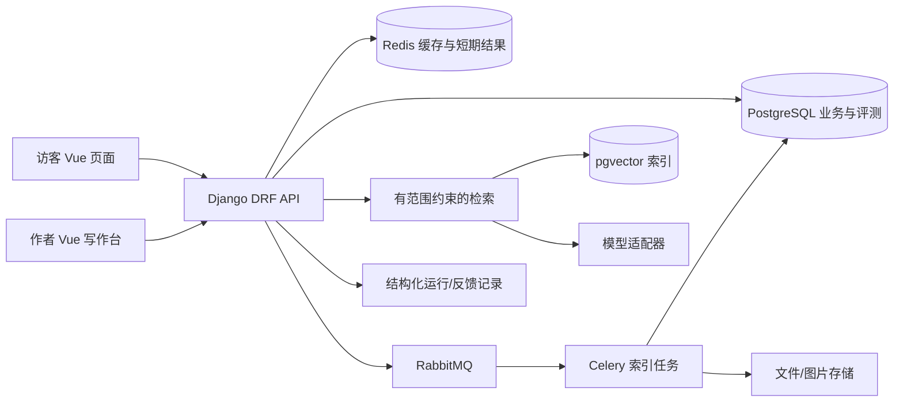

# Blog 设计文档 V2.0

> 状态：方案基线，2026-09-29。依据当前仓库代码和本次本地检查；目标值均为**待验证的验收门槛**，不是已达到的成绩。实现按 [缺陷跟踪表 V2.0](缺陷跟踪表V2.0.md) 逐项推进，数据库细节见 [数据库设计文档 V2.0](数据库设计文档V2.0.md)，指标口径见 [评测与测试升级方案 V2.0](评测与测试升级方案V2.0.md)。历史文档含已过时结论，以代码和本组 V2 文档为准。

## 1. 决策摘要与产品定位

产品定位为**可追溯的个人技术作品与面试问答站**：作者发布项目复盘、架构决策、性能实验和代码证据；访客可以读文章，也可向站内助手提问，答案须指向公开内容的具体段落，并明确区分事实、推断与“不知道”。主要使用者是求职者、面试官和愿意查阅项目实现的技术读者。第一版不做团队办公、协作知识库或通用文档平台；飞书已覆盖此类场景，本项目应靠“个人作品证据 + 可验证问答 + 工程决策过程”形成差异。

核心闭环：**写作 → 审核发布 → 版本化索引 → 访客提问 → 引用证据 → 反馈与评测 → 改进文章/检索**。面试官 3 分钟内能看到项目问题、我的取舍、数据证据和失败复盘；作者能解释每条链路的边界及指标，而不只说“调用模型”。

成功标准（建议先用 5 位非作者试用者验证）：

| 用户任务 | 目标门槛 | 证据 |
| --- | --- | --- |
| 找到一篇项目复盘并理解技术取舍 | 5 人中至少 4 人在 2 分钟内完成 | 录屏/任务记录 |
| 用问答找到某项设计的原文依据 | 至少 4 人在 3 次交互内找到可点开的来源 | 任务记录、引用日志 |
| 作者写作并恢复未发布草稿 | 20 次断网/刷新演练零丢稿 | 端到端测试 |
| 面试演示 | 3 分钟展示一条完整证据链且无错误 | 固定脚本、演示环境 |

这些是产品实验门槛，样本较小，不能代表大规模用户满意度。

### 2026-09-29 第一轮代码升级记录

已完成注册权限收紧、匿名草稿过滤、文章评论/相关文章发布状态校验、生产安全默认值和 multipart 请求头修正。B-005 本轮增加独立的 `blog_media` 存储：本地/Compose 使用文件，非本地默认 Railway S3 Bucket，缺少 5 个必需环境变量则启动失败；私有 Bucket 对象只经本站 `/media/blog/<随机文件名>` 受控流式接口读取。读取接口只允许已生成的 PNG/JPG/GIF/WebP 键，核验图像内容与扩展名，拒绝未知对象，并返回 MIME、`nosniff` 和长期不可变缓存头。现有同格式 `/media/blog/...` 链接保留；提供校验、SHA-256 复核、冲突即停且不删除源文件的迁移命令。上传仍由 Pillow 完整解码并限制大小、像素及帧数。

B-005 本地存储升级当时的整套 Django 测试 **118 项通过**（历史记录；当前累计安全回归见下）。其中媒体上传/读取/存储配置/迁移覆盖 10 项；`ruff check backend` 与 `black --check backend` 均通过。Django 生产配置模拟 `check --deploy` 通过（2 项已有说明的 HSTS 提示静音），缺少 Bucket 配置时 `manage.py check` 在加载 settings 阶段明确失败。代码和隔离文件存储回归不能证明 Railway 网络、Bucket 凭据、实际持久性和恢复可用；需按下文配置后在真实 Railway 环境验收，B-005 保持“待实站验证”，不得关闭。依赖选用 Django 项目现有 `Django==5.2.16`（5.2 LTS）+ `django-storages[s3]==1.14.6` + `boto3==1.43.97` / `botocore==1.43.104`；前者遵循 Django 4.2+ `STORAGES` 接口，后两者实现 S3 兼容 API，版本来源为 [django-storages 1.14.6](https://pypi.org/project/django-storages/1.14.6/) 和 [boto3 1.43.97](https://pypi.org/project/boto3/1.43.97/)。Railway 文档确认 Bucket 为私有对象存储、当前使用虚拟主机式 endpoint；代理模式避免公开 Bucket 或长期预签名 URL。参考 [Railway Buckets](https://docs.railway.com/storage-buckets)、[Railway 通过后端代理文件](https://docs.railway.com/guides/storage-buckets-guide)、[django-storages S3 配置](https://django-storages.readthedocs.io/en/latest/backends/amazon-S3.html)、[Django 5.2](https://docs.djangoproject.com/en/5.2/releases/5.2/)。

#### B-005 发布、迁移与回滚

1. 创建 Railway Bucket 后，在应用服务 Variables 中使用 UI 的变量引用/自动注入，把 `BUCKET`、`ENDPOINT`、`REGION`、`ACCESS_KEY_ID`、`SECRET_ACCESS_KEY` 分别映射为 `BLOG_MEDIA_BUCKET_NAME`、`BLOG_MEDIA_ENDPOINT`、`BLOG_MEDIA_REGION`、`BLOG_MEDIA_ACCESS_KEY_ID`、`BLOG_MEDIA_SECRET_ACCESS_KEY`，并设置 `BLOG_MEDIA_STORAGE=s3`。endpoint/region/addressing style 按 Bucket Credentials 页给出的值；此代码默认新 Bucket 的 virtual-hosted URL。不要提交密钥到仓库、镜像、日志或 `.env`。
2. 在切换应用模式前，备份旧持久卷的 `MEDIA_ROOT/blog/`（只读复制），记录文件数和 SHA-256 清单。Windows PowerShell 可对备份目录执行 `(Get-ChildItem "<备份MEDIA_ROOT>\blog" -File).Count` 和 `Get-ChildItem "<备份MEDIA_ROOT>\blog" -File | Get-FileHash -Algorithm SHA256 | Export-Csv .\blog-media-sha256.csv -NoTypeInformation`。连接旧媒体卷的维护进程配置 Bucket 凭据后，先运行 `python manage.py migrate_blog_media_to_bucket --source <旧MEDIA_ROOT> --dry-run`，复核通过后再运行同命令去掉 `--dry-run`。命令完整解码允许格式、校验大小/帧数、校验目标对象 SHA-256；同名同内容视为已迁移，同名异内容立即停止；不删除源文件。
3. 部署前后检查命令输出的文件数/校验和，并用至少一张真实旧图和一张新上传图访问返回 URL，确认状态 200、图片可解码和 `X-Content-Type-Options: nosniff`。上传新图后重启/重新部署再访问，证明 Bucket 持久性；在隔离备份目标做读取恢复演练。备份恢复时先将保留的对象备份导出到隔离目录，再用该目录作为 `--source` 运行同一预检/校验命令迁入恢复 Bucket。没有真实 Railway 环境前均标待验证。
4. 回滚时将 `BLOG_MEDIA_STORAGE=file` 并恢复原 `media_data` 卷快照/旧部署；不要删除 Bucket 或本地备份。迁移为复制且旧 URL 路径不变，可按文件清单重跑/核验。Bucket 备份应保留独立对象副本及 SHA-256 清单；恢复到新 Bucket 前运行同一校验命令并抽样读回。确定新模式和备份均验收后，才由运维另行制定旧卷保留期限。

本仓库检查发现本地旧目录当前有两项：`9576259c8864413faee084a43bd4ed33.png`（1,538,467 字节，PNG 可完整解码，1200×800）和 `e8f1701e72ef431d9c925497d7278eca.png`（8 字节，不能被 Pillow 识别为完整图片）。迁移命令先做全量预检，有任一无效对象时不会写入 Bucket。先对照文章内容确认第二项是否仍被引用；经人工确认可排除后，从 `backend/` 目录运行 `python manage.py migrate_blog_media_to_bucket --source media --dry-run --exclude e8f1701e72ef431d9c925497d7278eca.png`，确认摘要后再移除 `--dry-run` 执行。源文件始终保留，不能用迁移结果代替备份。

公开边界：`blog/` 命名空间保存可嵌入公开文章的图片，读取无需登录；上传权限仍由后端操作员角色控制。文章尚未获批时，知道该图片 URL 的人仍可读取图片，因此不得在此处放私密附件。未来私有附件须用独立存储前缀/别名和对象级授权接口，不能复用这个公开媒体代理。

生产路径审计还发现 PythonAnywhere 脚本及旧部署指南显式使用 `BLOG_LOCAL_MODE=true` 和 `AGENT_SECURITY_ENFORCED=false`，与本设计的安全启动门冲突；该部署路径未修复前不可作为公网部署方案。

## 2. 当前系统事实与差距

现有主链：Vue 3 + Vite + TypeScript + Pinia + Element Plus；Django/DRF API；Celery；PostgreSQL + pgvector，SQLite 本地模式；Redis 缓存/任务结果、RabbitMQ 消息代理；LangGraph/自定义 Supervisor；Vditor 写作、md-editor-v3 预览。代码位置：`frontend/src/`、`backend/apps/agent_api/`、`backend/agent/`、`docker-compose.yml`。根 `agent/` 当前只有缓存，并非仍在维护的第二套源码；旧 `docs/architecture-analysis.md` 在这一点上已经过时。

目前更像功能展示台：入口包含聊天、MCP、审批、观测等多个页面，但面试官的首要任务是理解“作品和能力”；公开文章缺少结构化的决策、指标与证据展示；当前自动评测不能证明可靠性。第一轮改造前，本地 SQLite 模式 105 项测试有 3 项失败、2 项报错；强制安全模式有 20 项失败、3 项报错。第一轮改造后本地 110 项测试全部通过，Railway 安全配置模拟下选定的 8 项权限/代理测试通过。前端 `build:check` 通过，但入口 JS 约 1,058 kB（gzip 349 kB）。Railway 配置模拟的 `check --deploy` 无未静音告警，真实部署冒烟尚未完成。详情与原因见评测文档，旧 `docs/evaluation-report.md` 的“37 tests OK / 已完成”不可作为当前发布依据。

**当前上线阻断项**：Railway 安全配置已通过模拟检查，但真实 Railway 部署与健康检查仍待验证（B-003）；真实 Chromium 已验证图片/知识文档 multipart 上传和失败提示，CI job 已配置但远端首次 workflow 尚待观察（B-004）；B-005 的受控图片路由、持久 Bucket 配置和旧图迁移已实现并通过本地隔离回归，真实 Railway Bucket 连通、重部署持久、新旧图片抽样和备份恢复仍待验收。PythonAnywhere 示例明确标为非生产。首轮已关闭注册越权（B-001）及草稿公开读取（B-002）。以上实站/远端门禁验证完成前，不得宣称系统可公开部署。

## 3. V2 用户流程

1. **访客首页**：一句话介绍作品定位；三个精选项目卡片展示“问题、约束、我的决策、可验证结果”，再给“问这个项目”入口。不要让访客先理解 Agent/MCP 管理术语。
2. **文章页**：目录、预计阅读时间、技术决策卡片、架构图、量化结果、取舍及失败案例；引用显示文章版本、段落锚点和更新时间；每条回答可跳回正文。
3. **访客问答**：先推荐限定范围问题（如“为什么选 PostgreSQL 而非 MongoDB？”），默认只检索公开内容。无证据时说明缺口、提供相关文章，禁止编造经历。工具与审批管理只给作者/运维看。
4. **作者写作**：写作、预览、自动保存状态、草稿版本、发布前检查（标题、摘要、图片替代文本、失效链接、来源可见性），发布需审批；失败可恢复草稿。
5. **反馈闭环**：访客标记“有帮助/引用不对/没找到”；后台把问题归类为内容缺失、检索失误、回答失实、权限问题；再进入评测集。

**B-010 草稿缓存规则**：新草稿与文章编辑稿保存在浏览器 `localStorage`，键由 actor、workspace 以及新稿 UUID/文章 ID 构成；每个标签页的打开上下文单独放在 `sessionStorage`，过期记录按 30 天 TTL 清理。切换账号时只读新账号命名空间，旧账号草稿保留在本机且不会向另一账号显示。Vditor 自带缓存关闭，以页面级记录作为单一来源。编辑器完成初始化后再同步异步恢复的内容。并发编辑时，以相同草稿键收到的同源 `storage` 事件表示另一文档发生了写入；暂停自动保存，由用户选择载入另一个标签页的版本或保留当前版本覆盖。不能依赖 sessionStorage 的 tab ID 区分冲突，因为浏览器复制标签页时可能复制该 ID。

**B-015 浏览统计口径**：目前仅已发布文章的详情 GET 计一次浏览，采用 PostgreSQL `F()` 原子自增；列表、归档、评论与相关文章请求不计，草稿详情不计。每次详情请求都计数，刷新页面和机器人尚未去重。面试展示时应称为“详情请求次数”，不能称为“独立访客数”。真库 100 并发请求误差 0 是发布门槛，机器人过滤/去重策略需要产品口径和实际流量数据后另行设计。

**B-016 SSE 代理**：前端经 Nginx 访问通用 Agent 流式 POST。Django SSE 响应设置 `X-Accel-Buffering: no`，Compose 的 Nginx 对精确流式路径关闭代理缓冲、缓存和 gzip，并保留 180 秒上游读取超时。这样可避免 Nginx 等待更多响应字节再向浏览器转发；仍须以真实 Nginx 容器测量首事件 P95 和完整事件顺序，模型自身首字时延单独统计。

**B-018 前端装载**：所有页面继续按路由懒加载。入口只注册页面真实使用的 19 个 Element Plus 组件，并导入这些组件及消息服务的样式；编辑器及管理页面代码留在各自路由 chunk。减少首屏传输与解析成本的判断以产物体积和真实浏览器数据共同支撑：本机构建入口 JS gzip 从 348.75 kB 降至 140.21 kB，入口 CSS gzip 从 62.80 kB 降至 28.47 kB；尚未把体积下降等同于真实用户 LCP/交互改善。

**B-021 评论规则**：评论是登录用户功能，服务端从 JWT 上下文决定署名，不接受客户端自报昵称；正文限 1–2000 字符，按账号及 workspace 固定 60 秒窗口最多 5 条。开发模式用本地缓存、部署环境用共享 Redis 缓存。新评论默认待审核，提交者收到明确回执；只有本 workspace 的管理员可查看待审核/已公开列表并批准、拒绝或隐藏，操作写入持久审计。公开列表和文章评论数仅包含已批准记录，历史已批准评论在迁移时保持可见。已登录读者可举报已公开评论，原因和补充说明只对本 workspace 管理员可见；同一账号对同一评论只存一次，每小时最多提交 10 条新举报，管理员可驳回或隐藏评论，处理写审计。匿名读者目前须先登录才能举报。`0037` 新增按真实用户 ID 和 workspace 限定的评论/举报临时限制：管理员需填写证据原因及 1～30 天期限，期限自动结束，也可提前解除；每次限制允许一次申诉，管理员可接受或维持，状态变化留审计。被限制者仍可阅读、写文章和记私有笔记，旧评论与举报不被删除。该能力在本地实现，正式运营响应时限及真实共享 Redis 多实例仍需验收。若未来开放匿名评论或举报，必须重新评估滥用风险。

**B-022 管理入口与定时任务**：安全状态和审计页面仅在管理员导航显示，`/security` 路由另有管理员守卫，真正数据授权仍由后端校验。已登录页面不再重复收集账号密码。Compose 的 Celery Beat 有实际用途：`CELERY_BEAT_SCHEDULE` 每 30 秒调度文档摄取 outbox 派发任务到 `documents` 队列；它对任务投递恢复有帮助，但真实 broker/worker 中断演练仍按 B-014 验收。

**B-024 面试官公开路径**：落地页可直接进入 `/blog`，匿名访客可打开默认公开 workspace 的已发布文章及深链接，也可使用公开博客助手询问文章；不需要工作台账号。访客页面只呈现阅读、公开问答与登录入口，不显示写作、删除、索引同步或评论输入。登录作者仍使用工作台外壳和原写作流程。公开路由只改变前端可达性，后端继续按发布状态和 workspace 过滤；非默认 workspace 的文章不会自动成为默认公开站点内容，若未来做多租户公开主页需另设计显式站点路由。

**B-025～B-028 体验路线**：用户新增“阅读时直接可视化编辑自己的文章、容易找到文章、私有笔记与 AI 汇总笔记”目标。B-025A 用迁移 `0035` 和待审修订解除编辑已发布文章时公开链接消失的风险；B-025B 把现有 Vditor `wysiwyg` 放到阅读页，隐藏源码模式切换，并复用按账号/空间/文章隔离的本地草稿。B-026 保留旧列表 API，并新增服务端分页发现接口、组合筛选与 URL 状态保留。B-027 用 `0036` 独立私有笔记与真实用户 ID 所有权，文章页选段落后可打开侧边笔记；保存、搜索、编辑、删除恢复走本人专属 API，投稿入口改名“我的文章”。B-028 沿用写作助手端点及模型配置，只接受笔记 ID，由服务端做所有权检查、长度与调用次数限制，再将明确标注来源的可编辑 Markdown 交还用户核查。各项本地浏览器路径已通过；真 PostgreSQL、共享 Redis、真实模型、移动/桌面端和用户任务仍待验证。技术取舍、指标与分阶段回退见 [写作阅读与笔记体验升级计划 V2.1](写作阅读与笔记体验升级计划V2.1.md)。模型 mock 结果不能作为真实摘要质量证据。

兼容与回滚：旧全局键 `blogWriterDraft` 和旧 Vditor 键 `blog-vditor-cache` 不导入新缓存，也不自动删除，避免把历史内容错误归属到当前账号。回退前先将重要未提交草稿导出/复制到安全位置或提交服务端；旧版本不会识别 `blogWriterDraft:v2:*`，但本次代码不会清除这些键，重新升级后仍可恢复。若旧版写入全局缓存，只在确认已备份所需内容后再手动处理旧键。此功能没有数据库迁移；回退前端代码即可回滚逻辑，不应清理用户浏览器缓存。

验证记录（2026-09-30）：Windows Edge Chromium 下真实 Playwright suite **5/5** 通过，其中 B-010 的 3 个测试验证 20 种 Markdown 原文往返、刷新/断网/服务端失败缓存、账号与文章隔离及同文章双标签冲突恢复。此证据不是 20 次真实用户断网演练；产品体验门槛仍需用户研究验证。CI 配置了相同 Chromium suite，远端 GitHub Actions 首次运行仍待观察。

移动端、键盘操作和慢网络从第一轮验收就纳入。首屏和编辑器分包；管理后台采用权限可见性但真正授权在服务端。所有主要请求有 loading/empty/error/retry 状态。公共页面应在无需登录的独立浏览器会话中验收。

## 4. 目标架构与技术选型

| 决策 | 选择及原因 | 未选方案与触发重评条件 |
| --- | --- | --- |
| Web 前端 | 保留 Vue 3 + TypeScript + Vite：现有代码与组件可复用，路由懒加载已实现，重写成本无收益。Pinia 只放跨页身份/偏好，表单状态留组件。 | React/Next.js 需重写；如 SEO 被实测证明影响公开访问，再评估预渲染/SSR，不先整体迁移。 |
| UI | 保留 Element Plus 用于后台表单/表格；访客页使用轻量自有组件与设计 token，避免后台控件侵占作品展示。 | 全量换 UI 库会造成大量回归；只有无障碍或性能实测不达标时替换具体组件。 |
| Markdown | **保留 Vditor 作为唯一编辑器**（已有 WYSIWYG/即时渲染/分屏及上传适配），暂保留 md-editor-v3 的预览组件，随后用同一套 Markdown 解析/安全策略完成编辑与展示一致性测试，再决定是否统一渲染器。官方能力见 [Vditor 文档](https://github.com/Vanessa219/vditor/blob/master/README.md)、[md-editor-v3 项目](https://github.com/imzbf/md-editor-v3)。 | 现在同时有 Vditor 编辑和 md-editor-v3 展示，主题与语法可能不一致；不盲目引入第三套插件。若 Vditor 在 20 篇代表文章的格式往返测试中丢失内容，再比较 md-editor-v3 编辑模式。 |
| API/业务 | 保留 Django 5.2 + DRF：现有模型、迁移、认证和管理功能成熟；拆分 View/服务/权限策略，统一输入校验和错误协议。 | FastAPI 异步优势对当前数据库事务和短请求不是决定性收益；若实测 API 层吞吐瓶颈且 I/O 为主，再局部评估。 |
| Agent | 保留 LangGraph 仅用于有状态、多步和审批流程；简单“公开内容检索→回答”走明确、可测的服务流程。路由/检索/生成分别记录结果。 | 全部问题强制多智能体增加成本与不可控性；仅当多步任务成功率明显优于简单流程时启用复杂编排。 |
| 异步 | 保留 Celery + RabbitMQ 处理文件抽取/索引；Redis 作缓存和短期结果。RabbitMQ/Redis 分工符合 [Celery 5.6 官方比较](https://docs.celeryq.dev/en/stable/getting-started/backends-and-brokers/)。取消无任务的 Beat 或给出真实维护任务后再保留。 | 单机演示可 eager；线上任务需幂等、重试和死信/失败可见。减少组件应以运维成本实测为依据。 |
| 数据/检索 | PostgreSQL 为唯一持久业务真源，pgvector 按模型版本索引；SQLite 仅本机演示。先比 exact/关键词/混合检索，再优化 HNSW。详见数据库文档。 | 独立向量库/搜索引擎在数据规模、延迟与运维证据不足前不引入。 |
| 部署 | 第一条正式部署路径为 Compose + PostgreSQL；本机 SQLite 仅便于开发。对象文件用持久卷起步，公开运行前验证备份恢复、HTTPS、密钥配置、限流。 | 多平台同时宣称支持会放大验证成本；其他部署路径在主路径达标后再确认。 |

模型服务必须经适配器返回 `provider/model/model_version/algorithm_version/dimensions/normalized/corpus_version/index_version`；只有显式配置 `RAG_EMBEDDING_MODE=local_hash` 才允许使用带独立身份的确定性本地 hash。远端服务失败不得自动切换空间；未固定模型 release 或身份不匹配时明确失败/跳过并告警。离线哈希向量只能证明流程可跑，不能证明语义检索质量。所有模型相关数字分别标注“真实模型”和“离线替身”。

## 5. 可讲述的工程设计

| 面试问题 | 应展示的工程证据 | 真正值得讨论的取舍 |
| --- | --- | --- |
| 为什么检索不是直接把全文塞给模型？ | 带 source ID 的切片、Top-K 实验、Recall@5 与延迟曲线 | 召回/成本/上下文污染 |
| 为什么保留规则路由？ | 路由混淆矩阵、误路由案例、复杂路由回退条件 | 可解释性与泛化 |
| 怎么证明“答案有依据”？ | 人工标注事实与引用、引用精度、负例拒答测试 | 有来源不等于来源支持结论 |
| 发布与索引如何一致？ | 审批状态机、revision/index job、失败重试、回滚演练 | 事务与外部任务不能靠一个数据库事务覆盖 |
| 数据库为什么选 PostgreSQL？ | 多租户约束、索引/查询计划、pgvector 对照实验 | 一致性与运维复杂度 |
| 如何安全上线？ | 匿名权限矩阵、跨 workspace 测试、备份恢复记录 | 默认拒绝与逐步开放 |

演示内容必须用真实实验截图和可复现脚本更新，不能拿建议门槛当成果。作品文章推荐模板：问题/约束 → 候选方案 → 决策与理由 → 实现图 → 数据与复现步骤 → 故障/局限 → 下一次改进。

## 6. 分阶段实施与发布门禁

| 阶段 | 交付范围 | 验收与回滚 |
| --- | --- | --- |
| P0 安全与可用性 | B-001～B-005；修复注册提权、草稿泄露、上传、生产默认配置；补对应回归测试 | 安全负例 100% 拒绝，核心上传/发布链路通过；一项未通过即不公开部署。先保留旧 schema，代码可回滚。 |
| P1 可复现基线 | 修复现有 5 个测试问题；生产/本地两套 CI；评测数据集与评分器 V2；PostgreSQL 集成测试 | 测试全绿、无外网依赖；所有指标有分母/环境/版本。 |
| P2 产品体验 | 面试官首页、证据化文章、引用跳转、草稿恢复、图片对象存储、编辑/预览一致性 | 完成 5 人任务测试与 20 次断网恢复演练；不合格只回滚对应页面/开关。 |
| P3 质量与性能 | 检索 A/B、索引版本、缓存、分包、可观测与成本控制 | 达到评测文档门槛；每轮只更改一个检索变量并保留前一索引。 |
| P4 正式发布 | HTTPS、备份恢复、监控告警、运行手册、演示数据 | 通过发布清单和恢复演练后再开放公网。 |

每个缺陷一条可复现用例、一项最小变更、一项回归检查。先加失败测试，再修复，再运行关联测试和完整门禁；schema 采用扩展→回填→切读→收缩，禁止把权限、数据库、编辑器和 RAG 同时换掉。

## 7. 开放问题

公开站点是否只展示作者个人作品、是否允许访客投稿、是否支持多作者 workspace，需要用产品试用结果确认；当前按“作者写作、访客只读提问”设计最低风险的正式版本。模型供应商、月度成本上限和目标部署环境在真实负载基线测出后确定，不为面试叙述虚构性能。

## B-007 权限实现与验证（2026-09-29）

当前身份模型为 `UserProfile.role` 的 visitor/operator/admin 层级和单一 `workspace_key`。匿名注册不能指定角色或 workspace；认证 API 从 JWT 对应用户的 profile 取身份，不信任客户端 `X-Workspace`。已发布文章、文章图片读取和公开博客助手是公开边界；草稿、知识库/文档/搜索、通用 Agent RAG（含 SSE）、审批和安全管理接口受服务端角色及 workspace 校验保护。通用知识和管理 API 的访问矩阵及模型限制见数据库设计文档。

B-007 回归证据：默认本地配置和 `AGENT_SECURITY_ENFORCED=true`、`DEBUG=false` 的隔离生产安全配置均完整运行 `apps.agent_api apps.core`，当前累计各 143 项通过；新增角色矩阵 7 项通过。安全配置使用临时 SQLite/媒体目录与测试密钥，不依赖生产凭据或 Railway。审查中修复了知识库/文档列表、私有知识搜索、通用 Agent chat/SSE 未限制 operator 的真实越权风险。本地证据不代表远端 CI 已运行；B-003/B-005 的 Railway TLS 与 Bucket 持久性验收仍未完成。

## B-011 认证会话过渡设计（2026-09-30）

后端已增加独立 `/auth/cookie/` 路径：先从 `/auth/csrf/` 获取 CSRF token，再在登录、注册、刷新、退出请求中提交 `X-CSRFToken`。refresh 只放在 `blog_refresh` HttpOnly Cookie，路径限制到 `/api/agent/auth/cookie/`，SameSite=Lax；生产随 `CSRF_COOKIE_SECURE` 使用 Secure。access 保持 15 分钟短期 JWT，经响应 JSON 交给前端，仅放在运行内存。SimpleJWT blacklist 使 refresh 旋转后的旧 token 和退出后的当前 token 失效。跨源本地开发只允许显式列出的 CORS origin 携带凭据，5174 已列入；Railway 生产优先同源，若改跨站部署须重新审查 SameSite、CSRF_TRUSTED_ORIGINS 与 HTTPS。登录不再创建不必要的 Django session。

选择沿用 SimpleJWT 的签名 access 与数据库 blacklist，是因为现有 API/权限链路已使用 JWT，增量迁移较小；refresh 撤销记录需要在进程重启后仍有效，数据库表可随现有 PostgreSQL 事务与备份管理。相较于仅靠短过期时间，blacklist 能阻断旧 refresh 重放；相较于另建 Redis 会话服务，现阶段减少一套额外运行依赖。HttpOnly 让页面脚本无法读取 refresh，但不能消除 XSS 对当前会话的滥用，因此仍保留输入净化、短 access 和 CSRF/Origin 防护。生产 Cookie 必须经 HTTPS，同站部署可使用 Lax；本地 Vite/桌面优先通过同源代理访问 API，避免 localhost 与 127.0.0.1 混用导致 Cookie 不发送。

前端已切换为 cookie+内存：启动时尝试刷新，旧 localStorage refresh 经 CSRF 保护的 `/auth/cookie/upgrade/` 单次旋转为 Cookie 并立即清除本地旧键；同一标签的并发刷新去重，支持 Web Locks 的浏览器在多标签之间串行刷新。退出需等服务端撤销成功，再清理本地状态并通过 BroadcastChannel 通知其他标签跳转登录；服务端不可达时明确提示退出未完成。知识文档 XHR 上传也先更新 access 并以内存令牌发出。浏览器脚本不能读取 refresh，但短期 access 在内存中仍可被已执行的恶意脚本滥用，故 XSS 防护继续必要。

安全复核还发现：旧版登录曾创建 Django session，部分 Agent API 若直接信任 `request.user`，会在 refresh 撤销后仍把旧 session Cookie 当作身份。现在 Agent 安全上下文只接受有效 Bearer JWT，旧 session Cookie 单独访问管理 API 会被拒绝；登录审计仍显式记录真实用户。当前 access 是无状态 JWT，退出后若令牌已被复制，最长可能存活到其 15 分钟过期；发布前必须把这一窗口作为残余风险说明，必要时再引入 access 版本号或服务端会话机制。

旧 `/auth/login/`、`/auth/register/`、`/auth/refresh/` 暂保留 JSON refresh 契约，仅供过渡客户端；新前端不再调用它们。确认旧客户端升级覆盖、生产同源 Cookie 行为及回滚准备后再移除旧 JSON refresh 路径。回滚时应回滚前后端同一版本，不关闭 blacklist 或复用已撤销令牌。本机 Edge 浏览器在隔离服务下已验证 9/9 完整 E2E，另以 5174 跑认证专项 4/4；5174 测的是前端入口端口，尚非 Electron/桌面壳真实验收，也未部署 Railway。

## B-012 向量空间隔离（2026-09-30）

实现为每个存储与查询向量绑定完整嵌入空间身份，SQLite 与 pgvector 均精确匹配 provider、model release、算法、维度、归一化、corpus 和 index 版本；迁移将历史身份不明向量隔离但保留数据。远程请求异常不回退到本地 hash，日志不包含密钥或文档正文。默认、安全后端完整 suite 各 143/143 通过；B-012 仍需 PostgreSQL 新增 SQL 断言、真实 provider 配置、遗留语料重建与备份恢复验收，未关闭。Railway 未部署。

## B-014 文档入库一致性与后台恢复（2026-09-30）

上传、重建和博客文章发布先在业务事务中写入 `DocumentIngestionJob` outbox 行；只在事务提交后将 job UUID 作为 Celery task ID 投递。RabbitMQ 暂不可用时 outbox 保留并进入带退避的有限重试，Beat 每 30 秒扫描待投递/过期租约；最多 5 次后标记 `failed`，operator/admin 显式重建会生成新 job。worker 重投按 UUID 幂等，过期租约允许新 attempt 接管，旧 attempt 不能覆盖新 attempt。

文档切片按 `ingestion_generation` 暂存。文本抽取和 embedding 请求在数据库事务外执行；全部成功后，worker 在单一短事务内写入新代次的 ORM/pgvector 行、更新 `active_ingestion_generation` 并清理旧代次。检索只匹配活动代次，因此重建期间旧 READY 索引继续服务，提交后新索引一次性可见。`DocumentIngestionJob.status/failure_code` 是任务诊断真值；`Document.status` 保持最后可服务索引 READY，失败码另存为 `ingestion_error_code`。首次入库待处理时为 PENDING。公开博客文章只同步公开文章内容；知识附件仍受 operator/admin 与 workspace 访问边界保护。

迁移 `0032_durable_document_ingestion_outbox` 后，既有切片代次 0 继续活动，不要求上线前搬迁或删除旧内容。成功重建后，代次指针原子切到新代次，旧切片在该事务中级联清除。回滚前先备份数据库并停止 Beat/worker/写入；确认活跃切片仍满足每文档每 chunk_index 唯一后，才回退应用和迁移。不得在验收前手动清理 outbox、旧切片或源文件。

## B-008 回答评测与证据边界（2026-09-30）

评测评分器 `evidence-rubric-1.2` 只按显式人工审核的原子事实、禁止主张、来源 ID 与支持文本模式执行可审查规则；每个指标保留分子、分母、状态和原因，回答证据轨迹记录 fact/source ID 与支持结果。事实忠实度始终要求可见来源支持；仅当该事实要求行内引用时才要求回答引用该来源。错误引用、缺证据、未映射主张或标注不完整不会得到“有来源即正确”的高分；无需引用的题型不把引用指标误报为待判定。证据不足显示 `needs_review`。拒答质量只用于标记应拒答的题，工具成功率/延迟/token 用量独立记录。旧历史分数不重算，旧 heuristic 数据标为 `legacy`，不同 scorer 版本不可直接合并对比。

当前本地对抗评测与默认/安全配置后端回归通过，但内置 30 题仍 0 条人工审核；缺少 40 题冻结集、双人标注一致性和评分器误判率校准，因此只能证明反例没有被启发式捷径放过，不能证明产品回答可靠。B-008 不关闭，禁止将测试 reviewer fixture 或 mock 输出描述成人工质量结果。
