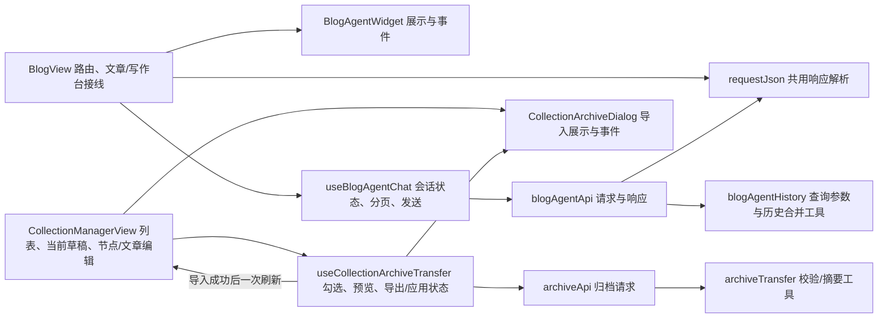

# I-014 前端页面职责划分

日期：2026-10-24。范围仅覆盖本轮核对后边界清晰的两条业务流程；保留用户已有页面与组件改动。

## 职责图

`BlogView` 仍拥有文章、写作、审核和路由状态。`useBlogAgentChat` 唯一持有悬浮问答的开关、输入、消息、会话 key、分页/加载状态；`BlogAgentWidget` 只展示并发出事件。博客问答 API 使用原 GET/POST 地址、参数及错误文案，并与页面复用原有 JSON/非 JSON 响应解析；页面挂载时仍只调用一次历史读取。

`CollectionManagerView` 仍拥有领域列表、当前草稿、节点和文章操作。`useCollectionArchiveTransfer` 唯一持有批量选择与归档导入导出状态；`CollectionArchiveDialog` 只显示文件、预览、冲突选择与提交事件。列表作为只读 computed 传入，导入成功通过页面提供的 `loadList` 回调刷新一次，不自建第二份领域列表。`archiveApi` 只负责凭据、FormData、下载体及服务错误；已有纯工具继续负责文件校验和摘要。依赖均单向指向 API/工具，回调只向上通知，不从 API 反向导入页面。

未拆文章/写作台及领域节点编辑：它们当前与页面中的草稿、权限和路由状态共享较多，不存在本轮足够明确的边界。没有按行数目标机械拆分。

## 验证记录

见改进跟踪表 I-014 实施记录。测试环境为本地 Node 24.18、根 `.venv` 隔离 Django 测试服务及 Edge Playwright。自动化只证明所覆盖的界面和请求，真实用户路径、其他浏览器及生产流量仍须单独验收。
