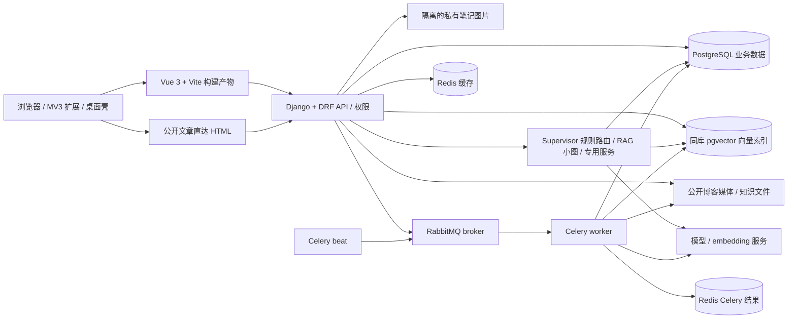

# 当前架构概览

本文描述当前仓库运行时边界（2026-10-24 源码快照）。业务代码与部署配置是事实来源；三条完整数据流和技术取舍见 [I-021 决策记录](I-021-当前架构与技术取舍.md)，未验收的架构目标见[缺陷跟踪表](缺陷跟踪表V2.0.md)。

## 当前部署路径

- **本地一键模式**：`start.bat` / `start.sh` 设置 `BLOG_LOCAL_MODE=true`，使用本地 SQLite 与单一 Django 入口 `127.0.0.1:8001`。本地模式是开发/演示降级，不等于生产数据库或异步服务验收。
- **热更新模式**：根目录 `restart.bat` / `restart.sh` 启动 Django `8001` 与 Vite `5174`。直接 `npm run dev` 默认 Vite `5173`，代理默认后端 `8000`。
- **Compose**：`docker-compose.yml` 将 Vue 静态文件置于 Nginx；Django、PostgreSQL + pgvector、Redis、RabbitMQ 与 Celery worker/beat 分离运行。实际变量以 `docker-compose.yml`、`.env.example` 和 `backend/config/settings.py` 为准。

## 请求与权限边界

浏览器 API 由 `backend/config/urls.py` 提供 `/api/health/`、`/api/agent/` 与 SPA 路由。业务 URL 按 `backend/apps/agent_api/api_urls/` 分域。当前 Web 客户端使用 HttpOnly refresh Cookie、CSRF 与内存 access token；已认证 API 按用户 profile 的 role/workspace 授权，不能用请求头把生产用户切到任意 workspace。公开注册只创建 visitor。权限细节与端点见[API 索引](api.md)。

公开文章媒体经受控 `/media/blog/<name>` 代理读取；私有笔记图片置于公开媒体根目录之外，并要求认证 owner/workspace。Compose 使用独立私有媒体卷。生产持久性和真实对象存储仍以缺陷表待验收项为准。

## 异步工作

文件解析/入库和评测批次等后台任务由 Celery 执行，RabbitMQ 是 broker；Redis 用作缓存/任务结果，文档入库的权威状态在 PostgreSQL `DocumentIngestionJob`，不能只看临时 Celery 结果。问答当前在 Django 同步/SSE 请求路径内执行，`AgentRun` 保存状态与结果，**没有**通过 Celery 排队或配置图 checkpoint。审批也由 Django 持久化并在管理员决策时执行。SQLite 本地模式与 Compose/生产拓扑行为不同。系统图只表示代码/Compose 已存在的路径，不表示实际生产 worker、消息可靠性或模型质量已完成验收。
