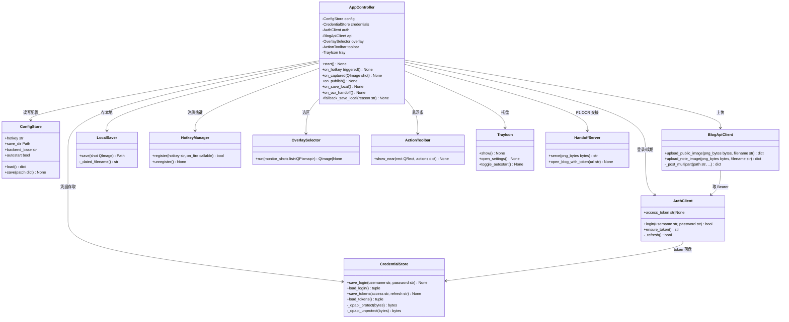
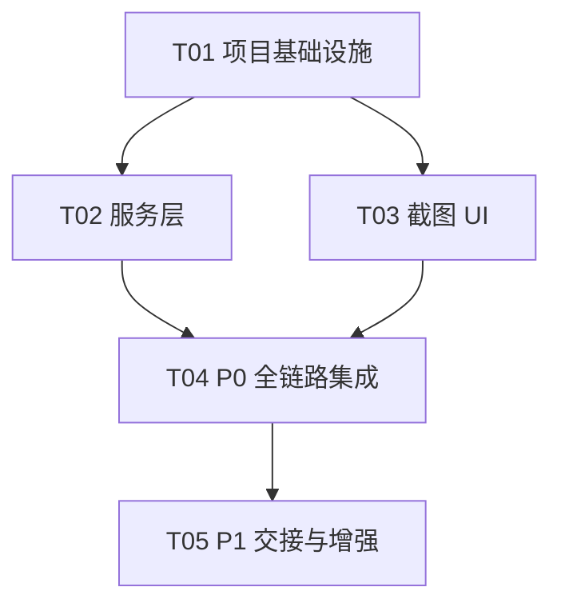

# 托盘截图小工具（screenshot-tray）技术设计文档

> 需求来源：需求池 P0（全局快捷键截图 → 悬浮条 → 发博客/存本地），P1（私有笔记去向 / 交给博客页 OCR / 开机自启）。
> 约束：仅 Windows 11；Python 3.13（项目根 `.venv`）；**不改后端现有接口行为**；最小改动、复用现有能力。

---

## 一、后端接口查证结果（设计依据，均已核对真实代码）

| 能力 | 端点 | 鉴权 | 请求 | 响应 | 出处 |
|---|---|---|---|---|---|
| 登录换 JWT | `POST /api/agent/auth/login/` | 无 | JSON `{username, password}` | `{token, access, refresh, user, session}`（`access` 与 `token` 同值） | `backend/apps/agent_api/views/auth.py` L31-72；路由 `api_urls/auth.py` L19；挂载于 `/api/agent/`（`config/urls.py` L46） |
| 刷新 JWT | `POST /api/agent/auth/refresh/` | 无 | JSON `{refresh}` | `{access, ...}`（simplejwt `TokenRefreshView`） | `api_urls/auth.py` L22 |
| **公开博客媒体上传（P0 主通道）** | `POST /api/agent/blog/images/` | `require_roles([OPERATOR])`，经 `context_from_request` 解析 `Authorization: Bearer <JWT>`（无 Django session 要求） | multipart，字段名 **`image`**；Content-Type 必须 `image/*` 且与实测一致；≤5MB；PNG/JPEG/GIF/WEBP；单帧≤20M 像素 | 201 `{url: "/media/blog/<hex><suffix>", markdown: ""}`（alt 取上传文件名 stem） | `backend/apps/agent_api/views/blog_articles.py` L194-286（`BlogImageUploadView`）；`require_roles` 见 `views/common.py` L135-152；Bearer 解析见 `agent/security.py` L67-69、L93-102 |
| 私有笔记图片上传（P1） | `POST /api/agent/blog/notes/images/` | `jwt_user_from_request`（Bearer JWT） | multipart 字段 `image`，≤5MiB，60 张/小时（429） | 201 `{id, url: "/api/agent/blog/notes/images/<id>/", original_name, byte_size, source_url, bound_to_note, created_at, requires_auth: true}` | `backend/apps/agent_api/views/blog_note_images.py` L31-34、L60-70、L89-145 |
| 私有图片读取 | `GET /api/agent/blog/notes/images/<id>/` | Bearer JWT，本人 + 同 workspace | — | 图片字节，`Cache-Control: private, no-store` | `blog_note_images.py` L207-232 |

关键结论：

1. **「复制 Markdown 链接」P0 必须走 `/api/agent/blog/images/`**：它写入公开 `blog_media` 存储，返回 `/media/blog/...` 公开 URL，未登录访客可读；私有笔记图片 URL（`requires_auth: true`）公开文章里会裂图。该接口要求 **OPERATOR 角色**，工具必须先登录。
2. 登录返回 `refresh`，access 过期后用 `POST /api/agent/auth/refresh/` 续期，工具端无需重新索要密码。
3. 错误响应统一为 `{"detail": str, "code": str}`（`views/common.py` L108-110），工具据此做失败分支。
4. 前端 B-045 OCR 交接（`frontend/src/features/blog/utils/screenshotHandoff.ts`）是**浏览器扩展 ↔ 页面**的 chrome.runtime 消息协议（get-meta → tile 分片 → ack，版本 `screenshot-v1`，入口在 `BlogView.vue` L584-625 打开 `ScreenshotOcrDialog`）。托盘工具不是扩展，**不能直接复用该消息协议**，P1 需要桥接设计（见 §7）。

---

## 二、Part A：系统设计

### 1. 实现方案与选型

#### 1.1 核心技术挑战

1. **全局热键**：Windows 原生 `RegisterHotKey`（user32）最可靠；第三方 `keyboard` 库依赖低层钩子，在管理员窗口/安全桌面下失效且有杀软误报风险。
2. **跨显示器 + 高 DPI 全屏遮罩选区**：多显示器、每屏不同缩放比（100%/150%）时坐标换算最容易出错。必须用 per-monitor DPI aware 方案，物理像素选区 → 按屏抓图裁剪。
3. **托盘常驻**：需要系统托盘图标 + 菜单，且主循环要同时服务热键消息与 UI。
4. **抓图与 PNG 编码**：尽量不引 Pillow，用框架自带能力。
5. **凭据安全存储**：密码/JWT 不能明文落盘，用 Windows DPAPI（`CryptProtectData`，ctypes 调用，零依赖，绑定当前用户）。

#### 1.2 选型对比

| 方案 | 体积 | 多显示器/高 DPI | 热键 | 打包 | 结论 |
|---|---|---|---|---|---|
| **A. PyQt6（推荐）** | 单轮子约 50-70MB | ✅ Qt6 默认 per-monitor DPI aware；`QScreen` 按屏抓图（`grabWindow`）天然支持多屏；跨屏遮罩 = 每屏一个无边框 `QWidget` | ✅ ctypes `RegisterHotKey` + `QAbstractNativeEventFilter` 收 `WM_HOTKEY`，零额外依赖 | PyInstaller onedir 稳定 | **推荐**。UI（遮罩、悬浮条、托盘菜单、配置对话框）一套框架全包，DPI 行为最正确 |
| B. pystray + keyboard + PIL + tkinter | 小（约 10MB） | ❌ tkinter 在 Windows 高 DPI 下需手动 `SetProcessDpiAwareness` 且缩放发虚；跨屏需多 Toplevel 手工拼坐标 | ⚠️ keyboard 全局钩子，管理员窗口失效、易被杀软标记 | 依赖杂（4 个包各管一段） | 否决。P0 硬性要求多显示器 + 高 DPI，tkinter 是最大短板 |
| C. 纯 win32 API（ctypes） | 0 依赖 | 理论最优 | 原生 | 无打包问题 | 否决。遮罩选区/悬浮条/托盘菜单全手写 GDI，工作量与维护成本远超收益，违背"最小改动" |

**最终方案：PyQt6 + requests + ctypes（标准库）。** 全部第三方依赖仅 2 个：

- `PyQt6`：托盘（`QSystemTrayIcon`）、遮罩选区窗口、悬浮条、热键消息循环接入、抓图（`QScreen.grabWindow` → `QPixmap` → PNG）。
- `requests`：HTTP 客户端（multipart 上传、JWT 登录/刷新）。multipart 用 `urllib` 手写过于易错，requests 是最务实选择。

不引入：Pillow（Qt 自带 PNG 编码）、keyring（DPAPI 两个 ctypes 函数即可）、keyboard（原生 RegisterHotKey 更可靠）。

#### 1.3 架构模式

分层 + 单例主控制器（简化 MVC）：

```
main.py (入口/单实例)
  └─ AppController ── 编排层：热键 → 遮罩 → 悬浮条 → 动作分发
       ├─ ui/        OverlaySelector / ActionToolbar / TrayIcon / SettingsDialog   （视图）
       ├─ core/      ConfigStore / CredentialStore / LogManager                     （配置与安全）
       ├─ services/  AuthClient / BlogApiClient / LocalSaver / ClipboardHelper      （服务）
       └─ handoff/   HandoffServer（P1：本地 HTTP 端点 + 深链）
```

### 2. 文件列表

全部新增文件放在 `tools/screenshot-tray/` 下（不触碰 backend/ 与 frontend/ 现有文件；P1 深链参数若需前端识别，属可选增量，见 §7）：

```
tools/screenshot-tray/
├── README.md                      # 使用说明、验收清单
├── requirements.txt               # PyQt6、requests（pin 版本）
├── run.bat                        # 用项目根 .venv 启动（pythonw 后台运行）
├── main.py                        # 入口：单实例锁、DPI 声明、装配 AppController
├── app/
│   ├── __init__.py
│   ├── controller.py              # AppController：全局编排与状态机
│   ├── constants.py               # 后端 URL、错误码映射、默认配置
│   └── errors.py                  # ToolError 体系（含用户可读文案）
├── core/
│   ├── __init__.py
│   ├── config_store.py            # config.json 读写（%APPDATA%/BlogScreenshotTool/）
│   ├── credential_store.py        # DPAPI 加密的凭据/JWT 存取
│   ├── log_manager.py             # RotatingFileHandler 日志
│   └── single_instance.py         # 命名互斥锁，防双开
├── services/
│   ├── __init__.py
│   ├── auth_client.py             # login / refresh，token 内存态 + DPAPI 落盘
│   ├── blog_api_client.py         # upload_public_image / upload_note_image（带重试与错误映射）
│   ├── local_saver.py             # 存本地：日期命名 PNG
│   ├── clipboard_helper.py        # 复制 Markdown 到剪贴板
│   └── hotkey_manager.py          # ctypes RegisterHotKey/UnregisterHotKey
├── handoff/
│   ├── __init__.py
│   └── handoff_server.py          # P1：127.0.0.1 临时 HTTP 端点（serve 截图）+ 深链打开
└── ui/
    ├── __init__.py
    ├── overlay_selector.py        # 全屏遮罩选区（每屏一个窗口，跨屏合并坐标）
    ├── action_toolbar.py          # 悬浮条：发博客 / 存本地 / OCR(P1) / 取消
    ├── tray_icon.py               # 托盘图标与菜单
    ├── settings_dialog.py         # 配置：热键、保存目录、账号、开机自启
    └── toast.py                   # 成功/失败提示气泡
```

### 3. 核心数据结构与接口



核心接口约定（简表）：

- `BlogApiClient.upload_public_image` → `POST {base}/api/agent/blog/images/`，`Authorization: Bearer <access>`，multipart 字段 `image`，文件名 `screenshot-YYYYmmdd-HHMMSS.png`（后端取 stem 作 alt）。成功返回 `{"url", "markdown"}`，**直接把 `markdown` 写入剪贴板**。
- `BlogApiClient.upload_note_image` → `POST {base}/api/agent/blog/notes/images/`，同鉴权；返回 `{"id", "url", "requires_auth": true}`，P1 使用。
- `AuthClient.ensure_token()`：内存无 token → 读 DPAPI 凭据自动登录；401 → 用 `refresh` 调 `POST /api/agent/auth/refresh/`；仍失败 → 抛 `AuthError`（UI 提示"未登录"，按钮一键回退存本地）。

### 4. 程序调用流程（P0 主链路）

```mermaid
sequenceDiagram
    participant U as 用户
    participant HK as HotkeyManager
    participant C as AppController
    participant O as OverlaySelector
    participant T as ActionToolbar
    participant A as AuthClient
    participant B as BlogApiClient
    participant S as LocalSaver
    participant CB as ClipboardHelper

    U->>HK: 按下全局热键
    HK->>C: on_hotkey()
    C->>O: run(各屏 QPixmap)
    O->>U: 全屏遮罩+拖拽框选 (Esc=取消)
    U->>O: 松开鼠标完成选区
    O-->>C: 选区 QImage
    C->>T: show_near(选区)
    U->>T: 点击「发博客」
    T->>C: on_publish()
    C->>A: ensure_token()
    alt 无 token / 过期
        A->>A: DPAPI 读凭据→POST /api/agent/auth/login/ 或 /auth/refresh/
    end
    A-->>C: access token
    C->>B: upload_public_image(png, filename)
    B->>B: POST /api/agent/blog/images/ (Bearer, multipart image)
    alt 201
        B-->>C: {url, markdown}
        C->>CB: 复制 markdown
        C->>U: 气泡「已复制 Markdown 链接」
    else 401/403/413/429/网络错误
        B-->>C: ToolError(code)
        C->>S: fallback_save_local(shot)
        C->>U: 气泡「上传失败已存本地：<路径>」
    end
    U->>T: 点击「存本地」
    T->>C: on_save_local()
    C->>S: save(shot)
    S-->>C: <保存目录>/2026/07/20260727-153001.png
    C->>U: 气泡「已保存」
```



P1 OCR 交接流程（选定方案 C，见 §7）：截图 → `HandoffServer.serve()` 起临时端点持有 PNG → 用默认浏览器打开 `http://127.0.0.1:5174/blog#handoff=...` → 前端（需小幅增量）从端点拉图并进入既有 `ScreenshotOcrDialog` 链路。

### 5. Anything UNCLEAR

1. **悬浮条动作语义**：PRD 未定义悬浮条是否在动作完成后自动消失、失败后是否保留待重试。设计取：动作发起即隐藏；失败回退存本地后给气泡并结束本轮（截图数据仍在内存，托盘菜单可加"重试上一张"P2）。
2. **上传 PNG 前是否压缩**：5MB 上限对多数截图足够；超限时首版直接走回退存本地，不做压缩（避免引依赖、避免画质争议），记入 P2。
3. **OPERATOR 角色缺失**：若登录账号非 OPERATOR，公开媒体上传 403。工具不区分角色，统一走回退存本地；文档注明需用 OPERATOR 账号。
4. **P1 深链需前端小增量**：前端目前只消费扩展协议（`screenshotHandoff.ts`），托盘深链需要在 `BlogView.vue` 增加 hash 参数识别（约几十行，不动后端）。若产品不接受动前端，P1 退化为方案 A（剪贴板 + 手动粘贴到识别页），设计在 §7 两者都给出。
5. **后端端口**：后端 Django 127.0.0.1:8001、前端 Vite 5174 为本地开发值，写成配置项（`backend_base` 默认 `http://127.0.0.1:8001`）。

---

## 三、Part B：任务分解

### 6. 依赖包

```
# tools/screenshot-tray/requirements.txt（装进项目根 .venv）
PyQt6==6.7.*          # 托盘/遮罩/悬浮条/热键消息循环/抓图，per-monitor DPI aware
requests==2.32.*      # HTTP 客户端（multipart 上传、JWT 登录/刷新）
# 打包（可选，P2）：pyinstaller==6.*（Windows，onedir 模式）
```

零依赖补充说明：DPAPI 用 `ctypes`（标准库）；互斥锁用 `ctypes.windll.kernel32.CreateMutexW`；HTTP 服务（P1）用 `http.server.ThreadingHTTPServer`（标准库）。

### 7. 共享知识（跨文件约定）

**配置文件** `%APPDATA%/BlogScreenshotTool/config.json`（UTF-8，缺字段用默认值）：

```json
{
  "backend_base": "http://127.0.0.1:8001",
  "blog_frontend_base": "http://127.0.0.1:5174",
  "hotkey": "ctrl+alt+a",
  "save_dir": "C:/Users/<user>/Pictures/BlogScreenshots",
  "save_layout": "{yyyy}/{MM}/{yyyyMMdd-HHmmss}.png",
  "autostart": false
}
```

**凭据文件** `%APPDATA%/BlogScreenshotTool/credentials.bin`：`json.dumps({"username","password","access","refresh"})` 的字节经 DPAPI `CryptProtectData`（Current User scope）后落盘；解密失败即视为无凭据。

**日志** `%APPDATA%/BlogScreenshotTool/logs/tray.log`：`RotatingFileHandler`，1MB × 3，格式 `%(asctime)s %(levelname)s %(name)s %(message)s`；关键动作（热键、上传、回退）必打 INFO，异常必打含栈 ERROR。

**错误码映射**（后端 `{"detail","code"}` → 工具文案与行为，见 `app/constants.py`）：

| 来源 | code/异常 | 用户文案 | 行为 |
|---|---|---|---|
| 登录 401 | `INVALID_CREDENTIALS` | 账号或密码错误 | 打开设置页，可回退存本地 |
| 上传 401/403 | `NOT_AUTHENTICATED`/`FORBIDDEN` | 未登录或无权限 | 尝试 refresh→重试一次→回退存本地 |
| 上传 413 | `VALIDATION_ERROR` | 图片超过 5MB | 回退存本地 |
| 笔记图 429 | `RATE_LIMITED` | 上传过于频繁 | 回退存本地 |
| 网络异常 | `ConnectionError/Timeout` | 无法连接后端 | 回退存本地 |
| 其他 5xx | `UPSTREAM_UNAVAILABLE` | 后端暂不可用 | 回退存本地 |

**其他约定**：所有 HTTP 超时 connect=3s / read=15s；时间戳一律本地时间 `YYYYmmdd-HHMMSS`；PNG 编码用 Qt `QImage.save(format="PNG")`；中文 UI 文案统一放 `constants.py`。

### 8. 任务列表（按依赖排序，≤5）

| ID | 任务名 | 产出文件 | 依赖 | 优先级 | 验收方式 |
|---|---|---|---|---|---|
| **T01** | 项目基础设施 | `tools/screenshot-tray/`：`README.md`、`requirements.txt`、`run.bat`、`main.py`、`app/__init__.py`、`app/constants.py`、`app/errors.py`、`app/controller.py`（骨架）、`core/__init__.py`、`core/log_manager.py`、`core/config_store.py`、`core/credential_store.py`、`core/single_instance.py` | 无 | P0 | `.venv` 内 `pip install -r requirements.txt` 成功；`python main.py` 启动无异常、日志落盘、配置/凭据文件按约定路径生成、双开被互斥锁拦截 |
| **T02** | 服务层（认证+上传+存本地） | `services/__init__.py`、`services/auth_client.py`、`services/blog_api_client.py`、`services/local_saver.py`、`services/clipboard_helper.py` | T01 | P0 | 冒烟脚本/REPL：login 拿到 token；对 `/api/agent/blog/images/` 传真实 PNG 得 201 `{url,markdown}` 且 `/media/blog/...` 可匿名访问；断网/超限/超 5MB 时抛对应 `ToolError`；本地保存文件名符合 `{yyyy}/{MM}/{yyyyMMdd-HHmmss}.png` |
| **T03** | 截图 UI（热键+遮罩+悬浮条+托盘） | `services/hotkey_manager.py`、`ui/__init__.py`、`ui/overlay_selector.py`、`ui/action_toolbar.py`、`ui/tray_icon.py`、`ui/toast.py`、`ui/settings_dialog.py` | T01 | P0 | 双显示器（不同缩放 100%/150%）下热键唤起遮罩正确铺满各屏、选区颜色无错位（对照物理像素截取）、Esc 取消；悬浮条出现在选区旁且不越屏；托盘菜单可打开配置并改热键即时生效 |
| **T04** | P0 全链路集成（发博客/存本地+失败回退） | `app/controller.py`（补全状态机与动作分发）、`app/constants.py`（文案补全）、`README.md`（验收清单） | T02、T03 | P0 | 端到端：热键→框选→发博客→剪贴板得到 `` 且可黏贴渲染；存本地生成文件；**人为制造**未登录/断网/超 5MB，均自动回退存本地并气泡提示；上传成功后托盘日志可追溯 |
| **T05** | P1 交接与增强（OCR 深链 / 私有笔记 / 自启） | `handoff/__init__.py`、`handoff/handoff_server.py`、`services/blog_api_client.py`（加 `upload_note_image`）、`ui/settings_dialog.py`（自启开关）、`ui/action_toolbar.py`（OCR 按钮）、`README.md`（P1 验收） | T04 | P1 | OCR 按钮起临时端点并打开 `http://127.0.0.1:5174/blog#screenshot-handoff=host/port/token`，前端（小增量）拉图进入既有 `ScreenshotOcrDialog` 链路产出可校对 Markdown；「发到私有笔记」上传后返回 `url` 形如 `/api/agent/blog/notes/images/<id>/`；勾选自启后 HKCU Run 键写入/移除生效 |

> 依赖图：T01 → (T02, T03 并行) → T04 → T05。T02/T03 无相互依赖，可并行。



### 9. P1 OCR 交接方案选型（三候选评估）

| 候选 | 做法 | 风险 | 结论 |
|---|---|---|---|
| A. 剪贴板 + 打开博客页 | PNG 放剪贴板，打开 `/blog`，用户手动粘贴进识别页 | 剪贴板被覆盖即丢图；前端**当前没有**"从剪贴板起 OCR"入口，仍需前端增量；步骤多 | 备选（零后端零前端改动时的兜底） |
| B. 深链 URL 直接传图片 | 图片 base64 塞 URL/query | URL 长度上限（IE/Shell 约 2MB 截断不可控）；截图几 MB 必炸；token 泄漏进浏览器历史 | 否决 |
| **C. 临时本地 HTTP 端点 + 深链引用（推荐）** | 工具内 `ThreadingHTTPServer` 绑定 `127.0.0.1` 随机端口，`GET /s/<token>.png` 返回 PNG（一次性 token、5 分钟过期、取后即焚）；深链 `http://127.0.0.1:5174/blog#screenshot-handoff=127.0.0.1:port/token` 只传引用 | 需要前端 ~30-60 行识别 hash 并 fetch 端点（不动后端）；端点只绑 localhost，且 token 一次性，风险可控 | **采用**。与既有 B-045 链路（`ScreenshotOcrDialog` → 本地 OCR → 逐块校对 → 私有笔记草稿）对接，不在工具内做 OCR |

---

## 附：与本设计相关的真实代码出处索引

- 登录：`backend/apps/agent_api/views/auth.py`（`AuthLoginView`）、`backend/apps/agent_api/api_urls/auth.py`
- JWT Bearer 解析：`backend/agent/security.py` L93-102（`jwt_user_from_request`）
- 公开媒体上传：`backend/apps/agent_api/views/blog_articles.py` L194-286（`BlogImageUploadView`，OPERATOR、multipart `image`、5MB、`/media/blog/...`）
- 私有笔记图片：`backend/apps/agent_api/views/blog_note_images.py`（5MiB、60/h、`requires_auth`）
- 统一错误结构：`backend/apps/agent_api/views/common.py` L108-110（`error_response`）
- B-045 交接协议（扩展侧）：`frontend/src/features/blog/utils/screenshotHandoff.ts`、`frontend/src/views/BlogView.vue` L584-625
