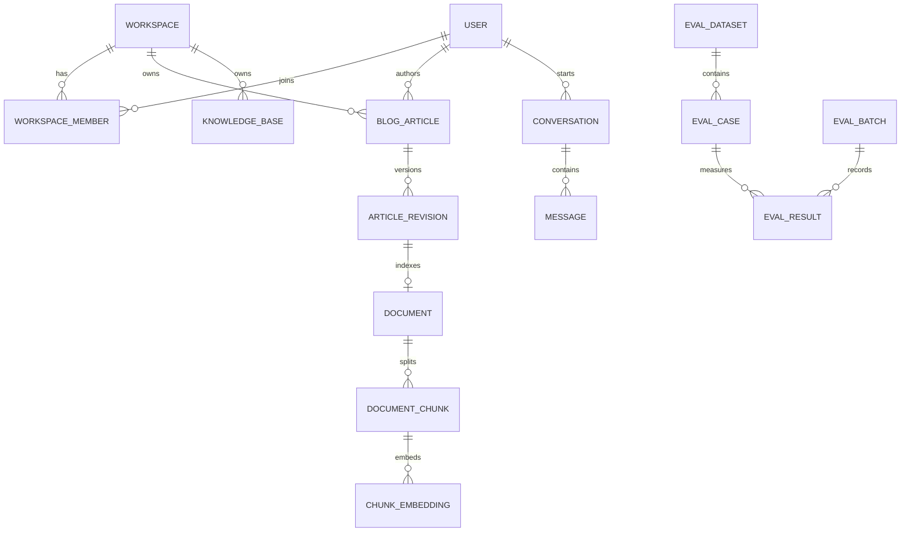

> **历史数据库决策与迁移记录（截至 2026-10-04）**：保留已完成缺陷的技术决策证据；不是当前完整字段清单，也不代表 Railway/生产验收完成。当前 schema 以模型和 migrations 为准，入口见 [database-current.md](database-current.md)。

# 数据库设计文档 V2.0

> 状态：V2 逻辑模型分阶段实施；截至 2026-09-30，评测 annotation 与 versioned async Dataset/Batch/CaseResult 已落入 Django schema，160 题数据内容和生产 worker 环境仍待完成。B-005 媒体代码已落实，Railway 实站验收待做。当前 schema 以 `backend/apps/agent_api/models/` 和迁移为准；其余未实现逻辑模型在各节标为目标。关联：[Blog 设计文档 V2.0](Blog设计文档V2.0.md)、[缺陷跟踪表 V2.0](缺陷跟踪表V2.0.md)。

## 1. 数据需求与存储决策

数据按公开作品、私有草稿、会话、知识索引、审批、审计、评测七类管理。目标：一条引用能反查到文章版本/切片；草稿绝不进入访客检索；不同用户与 workspace 的私有数据不能串读；任务可重试且不会把旧索引覆盖新文章；指标可复现、可比较。

| 方案 | 适合之处 | 对本系统的代价 | 决策 |
| --- | --- | --- | --- |
| PostgreSQL + pgvector | 外键、事务、JSONB、关系查询和向量共库；现有 Compose/迁移已接入。pgvector 可 exact 或 HNSW，官方说明 HNSW 以构建时间和内存换速度/召回。[来源](https://github.com/pgvector/pgvector/blob/master/README.md) | 向量索引需独立监控，模型维度/版本要管理。 | **正式环境主库**，优先减少跨库一致性与运维成本。 |
| SQLite | 零服务、本地演示容易复现。[SQLite 官方说明](https://www.sqlite.org/whentouse.html)指出它每库同时只允许一个写者。 | 与 pgvector 和并发生产路径不等价。 | 本地/单元测试；不拿 SQLite 指标充当生产数据。 |
| MySQL | 成熟的关系事务与工具生态。 | 当前应用需换迁移和向量实现；没有足够收益补偿迁移成本。 | 不选，若组织强依赖 MySQL 再重评。 |
| MongoDB | 文档字段变化灵活。 | 文章、版本、审批、租户和引用关系需要更多应用层一致性；现有 Django ORM 模型重做。 | 不选作业务真源；动态 trace 保留 PostgreSQL JSONB。 |
| Elasticsearch/OpenSearch | 全文、复杂分析与大规模搜索功能强。 | 增加同步、运维与故障面；当前数据量和相关性需求未证明必要。 | 当 PostgreSQL 检索在真实语料的质量/延迟门槛上失败，再引入。 |
| Qdrant/Milvus 等独立向量库 | 大量向量和专用检索功能。 | 双写、租户过滤、删除一致性增加复杂度。 | 暂不选；以规模和基准测试触发重评。 |

Redis 只保存可重建缓存、限流窗口和短期任务结果；RabbitMQ 只传任务；图片/PDF 原件放对象存储或备份覆盖的持久文件卷，数据库保存路径、哈希、元数据。评测标签和审计日志必须持久化，不依赖 Redis。

Railway 生产媒体选择 **Railway Storage Bucket**，不依赖应用容器本地盘。Bucket 为私有 S3 兼容对象存储，公开文章图片经过 `/media/blog/<32位随机hex>.<png|jpg|gif|webp>` 后端代理；原 Bucket URL、Key 与预签名 URL 不返给客户端。配置用 `STORAGES["blog_media"]` 独立于默认文件存储：非本地部署默认 S3 且 Bucket 名称、endpoint、region、访问密钥缺一即启动失败；本地及 Compose 明确用文件存储/媒体卷。依赖锁定 Django 5.2.16（现有版本）、django-storages 1.14.6、boto3 1.43.97；`STORAGES` 采用 Django 4.2+ 接口，S3 选项包含 Railway endpoint、region、SigV4、virtual addressing、无公开 ACL。见 [Railway Buckets](https://docs.railway.com/storage-buckets)、[Railway 文件代理模式](https://docs.railway.com/guides/storage-buckets-guide)、[django-storages S3 后端](https://django-storages.readthedocs.io/en/latest/backends/amazon-S3.html)。

旧 `/media/blog/...` 路径仍由同一读取接口提供。切换前需对旧卷 `MEDIA_ROOT/blog/` 做只读快照与 SHA-256 清单，再运行 `python manage.py migrate_blog_media_to_bucket --source <旧MEDIA_ROOT> --dry-run`，复核后去掉 `--dry-run` 执行复制。工具验证来源及目标完整解码/格式/哈希，不删除源文件，冲突则中止。当前工作区旧目录有一个可解码 PNG（1,538,467 字节、1200×800）及一个 8 字节不可解码文件；后者需对照文章引用人工判断，确认后显式 `--exclude e8f1701e72ef431d9c925497d7278eca.png`，不能清理或覆盖源文件。部署后抽样读取旧、新图片，重启服务后重读并在隔离目标演练备份恢复。回滚设 `BLOG_MEDIA_STORAGE=file` 并恢复原媒体卷；Bucket 与本地快照需保留直到恢复验收。以上为代码设计和隔离测试证据，真实 Railway Bucket 连接、跨部署持久性、备份恢复仍未实站验证。`blog/` 是公开文章图片命名空间。

**私有笔记图片（2026-10-04）**：`PrivateNoteImage`（迁移 `0042`）记录 owner、workspace、可空 note、对象键、SHA-256、来源与字节数。文件存于公开 `MEDIA_ROOT` 之外的 `private_note_media`，只经 JWT owner/workspace 校验的 `/api/agent/blog/notes/images/<id>/` 读回；前端取得字节后构造临时 blob URL。Compose 用独立 `private_note_data` 卷，前端 Nginx 不挂此卷。旧版若把图片写在 `MEDIA_ROOT/private-notes`，须先备份并运行 `migrate_private_note_media` 预演，再 `--apply` 校验搬迁。Railway/生产仍需为 `BLOG_PRIVATE_NOTE_MEDIA_ROOT` 配独立持久目录或改造专用私有 Bucket 并验收多实例读写，当前本地实现不等于真实生产存储已完成。

## 2. 当前物理模型：确认过的事实

### 当前身份与访问控制实现（2026-09-29）

当前 `UserProfile` 通过一对一关联用户保存 `role`（visitor/operator/admin）和一个 `workspace_key`，角色层级为 visitor < operator < admin；这不是多成员 workspace 模型，`WorkspaceMember` 仍是目标设计，尚未落库。公开注册一律创建 visitor 并落在默认 workspace，忽略客户端提交的 role/workspace。已认证请求按 JWT 对应 profile 取 workspace，不能用 `X-Workspace` 切换租户。

B-011 启用了 `rest_framework_simplejwt.token_blacklist` 的 `OutstandingToken` 与 `BlacklistedToken` 表，使用包自带迁移，不新增本项目模型迁移。refresh 签发与旋转产生 outstanding 记录；旋转和退出将旧 JTI 标为 blacklist，验证时拒绝重放。生产部署必须先执行 Django 迁移再开放新 cookie 端点，定期运行 SimpleJWT 的 `flushexpiredtokens` 清理过期记录。新前端不再存 JWT 到 localStorage；旧存储的 refresh 经单次升级端点旋转并撤销，但未上线且未升级的旧客户端令牌在过期前仍可能有效。旧 JSON 接口需有计划地下线。

撤销状态放 PostgreSQL 而非进程内存，是因为多实例和重启后仍需一致；现有项目已依赖 PostgreSQL，额外表与迁移的运维成本小于新建独立会话存储。`OutstandingToken`/`BlacklistedToken` 会随签发量增长，需监控行数及定期清理；频繁 refresh 或高并发时再根据实测延迟评估 Redis 辅助缓存，数据库仍保留权威撤销记录。

访问边界：公开已发布文章、只含已发布文章的博客助手与公开文章图片可匿名读取；草稿仅在其允许的工作空间/权限上下文中可读。知识库列表、文档列表、私有知识搜索及通用 Agent chat/SSE 现要求 operator/admin；文档上传也要求 operator/admin，删除等破坏操作要求 admin。文章草稿创建允许公开投稿契约，更新/提交发布要求 operator，最终审批要求同 workspace admin；图片上传要求 operator/admin，图片读取按公开文章图片处理。私有对话和项目按登录用户所有权及 workspace 过滤；管理/审计接口要求 admin。

安全 profile 完整测试 `apps.agent_api apps.core` 125/125，默认 profile 125/125；7 项新增矩阵通过真实登录 API/JWT，覆盖注册提权、跨空间读取/写入、伪造 workspace header、角色允许操作、审批与坏/过期/伪造 JWT。此处记录的是当前实现事实，不代表多成员 WorkspaceMember 模型已完成。

现有 `KnowledgeBase(workspace_key,name)` 已有联合唯一约束；`Document → DocumentChunk → EmbeddingRecord` 用外键/一对一。`EmbeddingRecord.vector` 在 SQLite 存 JSON；PostgreSQL 的 `agent_api_vectorindex` 由迁移创建。实测 PostgreSQL 16.14 + pgvector 0.8.6 从空库可完成迁移。384/1536 维使用 `vector` HNSW 表达式索引；3072 维超过 pgvector vector HNSW 的 2000 维限制，改为全精度 vector 存储并以 `halfvec(3072)` 建 HNSW 索引、以 halfvec operator 查询。修改 `0020` 用于新库，并增加 `0028_pgvector_3072_halfvec_index` 修复既有迁移状态。`BlogArticle` 有状态、slug、`knowledge_document`；`Conversation`/`ConversationProject` 用 `owner_username` 字符串；`UserProfile` 用 `workspace_key` 字符串；评测包含 `EvaluationCase.annotation` 人工审阅 JSON 和 `EvaluationRun.metrics` 评分证据 JSON；标注草稿与人工真值由 `review_status` 区分。`0029_evaluation_human_annotation` 增加标注列，不改写历史 run；历史分数由 API 标为旧评分版本。分类/标签全局唯一，尚不是 workspace 资源。

B-009 已新增物理表 `EvaluationDataset`（workspace+version 唯一、冻结快照/hash）、`EvaluationBatch`（dataset FK、idempotency key、provenance JSON、状态与 task ID）和 `EvaluationCaseResult`（batch+case_key/order 唯一、逐题 snapshot/status/attempts/run FK）；`EvaluationCase.case_key` 为稳定唯一 UUID。`0030_versioned_async_evaluations` 对已有 case 逐条回填 UUID 后再建唯一约束。冻结由应用层 `save()` 禁止修改快照和解冻；QuerySet.update、数据库管理员直接改写不受应用层拦截，生产数据库写账号/运维路径需继续按权限限制。Celery worker 消费 `evaluations` 队列。代码与隔离 SQLite task 测试通过，但真实 RabbitMQ/Redis worker、重复整批运行比较与 160 条完整标注集未验收；详见 [评测方案 B-009 实测](评测与测试升级方案V2.0.md#b-009-版本化异步评测批次实现记录2026-09-30)。

B-021 评论审核迁移 `0033_comment_moderation` 给 `BlogComment` 增加 `is_reviewed`、`reviewed_by`、`reviewed_at`，并把 `is_approved` 的新记录默认值改为 `False`。迁移会把既有评论标为已审核，保留原 `is_approved` 值；已批准评论继续公开。新评论的 `(is_reviewed=False,is_approved=False)` 表示待审核，管理员批准后为 `(True,True)`，拒绝或隐藏后为 `(True,False)`。公开接口与评论计数只按 `is_approved=True` 查询，审核接口另按文章 workspace 和管理员 JWT 过滤。每次真实状态变更写 `SecurityAuditEvent(comment_moderated)`，仅记录操作者、动作、评论/文章 ID 和时间，不复制评论正文。上线先迁移再开放新 API；回滚代码前需确保审核中的评论不会被旧版默认公开，并保留审核审计备份。

B-021 举报迁移 `0034_comment_reports` 新增 `BlogCommentReport(comment_id,reporter_name,reason,detail,status,reviewed_by,reviewed_at,created_at)`，唯一约束 `(comment_id,reporter_name)` 阻止同账号对同一评论重复入库。举报只接受本 workspace 的已公开评论；公开文章和评论序列化不包含举报数据。管理员按文章 workspace 读待处理举报；隐藏时原子更新评论可见性及该评论所有未处理举报，驳回只关闭当前举报。`SecurityAuditEvent(comment_report_reviewed)` 记录动作与资源 ID，不复制举报说明。举报说明最长 500 字；数据库记录需要在运营规则中规定保留期。上线按 `0033`→`0034` 顺序迁移；回滚代码前备份并处置未处理举报，撤销 `0034` 将删除举报表及历史举报。

B-021 账号限制迁移 `0037_blog_interaction_restrictions` 新增 `BlogInteractionRestriction(user_id,workspace_key,reason,expires_at,imposed_by,created_at,lifted_at,lifted_by,appeal_message,appealed_at,appeal_status,appeal_reviewed_by,appeal_reviewed_at)`，按 workspace、用户和到期时间建索引；旧评论与举报表均不改。限制绑定稳定用户 ID，按当前 workspace 和“未解除且未到期”判断，避免历史过期记录继续封禁。管理员在事务中锁定目标 `UserProfile` 后新增 1～30 天限制，禁止重复有效限制及限制管理员；被限制用户可在事务中对每次限制提交一次申诉。接受申诉或提前解除设置 `lifted_at`，驳回申诉保留到期时间；所有动作分别记录 `SecurityAuditEvent` 的资源 ID 和动作，审计不复制申诉正文。评论/举报写入前查询限制，公开浏览、文章与私有笔记 API 不受影响。正式 PostgreSQL 需验证并发管理员操作、旧库迁移及索引查询；回退旧代码前需导出限制与未决申诉，撤销 `0037` 将丢失这部分数据。

B-025A 修订迁移 `0035_article_revisions` 新增 `BlogArticle.publication_version` 和 `BlogArticleRevision(article_id,base_version,title,summary,cover_image,content,category_id,tags,status,submitted_by,created_at,reviewed_at)`。迁移把既有已发布文章版本回填为 1，新草稿从 0 开始，首次发布升为 1；后续每次批准修订递增。公开文章行始终保存当前已批准版本，待审正文只在修订表；审批 payload 绑定修订 ID 与基础版本。作者编辑时锁定文章并比较版本；管理员批准时锁定审批和文章，在事务内更新文章、标签、知识文档及修订状态。拒绝只改修订状态。发布前备份文章、修订、审批与知识文档，并在真实 PostgreSQL 演练旧库升迁、两位编辑者并发 409、批准后索引切换和恢复；回退旧代码前先导出并处置所有待审修订，不能恢复旧 `PUT` 的撤稿行为。撤销 `0035` 会丢失修订正文与版本证据，不能当作无损回退。

B-026 文章发现无 schema 迁移：保留旧列表 API 和工作空间/草稿权限边界，新增分页查询，在过滤后按 `published_at DESC, created_at DESC, id DESC` 稳定排序，页长最多 24。关键词先用标题、摘要、正文 `icontains`，分类/标签通过既有关系过滤，去重后计数与切片；现有 `workspace_key` 索引用于隔离。125 篇本地测试只证明结果完整性，不能证明 PostgreSQL 查询成本。真实数据达到运营规模后采样 `EXPLAIN (ANALYZE, BUFFERS)` 与搜索 P95，若扫描/延迟超标，优先评估 PostgreSQL 全文/三元组索引，不在证据不足时引入独立搜索集群。

B-027 私有笔记迁移 `0036_privatenote` 新增 `PrivateNote(owner_id,workspace_key,source_article_id,title,content,quote,version,deleted_at,created_at,updated_at)`，按工作空间、用户、删除状态和更新时间建组合索引。`owner_id` 是稳定认证用户外键，不用可改的用户名；API 只接受有效 JWT，不接受开发角色头或旧会话 Cookie。全部详情、编辑、删除、恢复与搜索都限定本人和当前 workspace，管理员也不默认越权。来源文章只允许同 workspace 已发布文或本人文章；笔记记录不进入博客投稿、审批和公开 RAG。更新采用 `version` 条件更新，过期写入返回 409；删除为软删除，可在回收站恢复。未保存的输入只留在当前页面，离开前提示；只有服务端保存成功后才保证刷新恢复。真实 PostgreSQL 需验证 `0036` 空库和既有库迁移、查询计划与并发版本冲突。回退前先导出本人笔记及删除状态；撤销 `0036` 将丢失所有私有笔记，不能当作无损回退。笔记属于私人数据，生产备份、删除保留期限和访问审计需单独制定。

B-028 汇总不新增数据库表或迁移。API 只按 `PrivateNote.owner_id + workspace_key + deleted_at IS NULL` 读取所选 ID，所有 ID 必须命中才会调用模型；来源映射、截断字数、模型与生成时间仅随响应返回，不把私有笔记正文或汇总自动写入文章、知识索引或日志。用户选择“存为私有笔记”时才经既有笔记创建接口持久化可编辑结果。生产共享 Redis 缓存按真实用户 ID 记录一小时调用计数，最多 10 次，缓存不可用时停止模型调用；需在多实例环境验证计数一致性。此计数不是永久审计账本，若未来要做计费与追踪，应另设计最小化、脱敏的审计记录及保留期限。

已确认的风险：

- `BlogArticleDetailView.get` 只按 slug/workspace 查询，未对匿名请求检查 `status=published`；状态过滤需覆盖所有详情、评论、相关文章和问答入口。
- 旧版 `BlogArticle.view_count += 1` 为读改写；当前公开文章详情已用 `F("view_count") + 1` 原子更新，草稿详情不增加计数。数据库仍需通过真实 PostgreSQL 的 100 并发详情请求验收，列表/归档/评论不计浏览；机器人与重复浏览过滤需要另定产品口径。
- `publish_article_to_knowledge_base()` 使用默认知识库；目标应显式传 workspace 与文章 revision，避免跨空间同步。
- B-013 已移除 vector-store 中的运行时 schema builder；`0020`/`0028`/`0031` migrations 负责扩展、表、索引及 identity 列。新代码遇到缺表/列/pgvector 运算符时以安全 503 指向 migration，不自动执行 DDL；本机新受限角色真库用例未运行，细节见文末。
- 向量检索现按完整空间身份和 `ready` 状态过滤；远程失败不再降级成不同算法的本地哈希。遗留向量迁移时进入隔离状态，需盘点并显式重建后才能参与检索（B-012 实测见本文末）。
- 图片经 Pillow 完整解码并核对 MIME，拒绝 SVG、截断和超限图片；现已采用本地/Compose 文件存储及生产私有 S3 Bucket 存储，所有公开文章图片由 `/media/blog/...` 受控代理读取，避免生产 `DEBUG=false` 时断链。Railway 的真实持久性与恢复仍待实站验证，且尚无独立恶意文件扫描。

## 3. V2 逻辑模型与约束

下面是**目标表/字段**，不是现有 Django model 的逐字段抄录。保留原表与外键，优先新增字段并回填；全新表仅在相应阶段使用。

| 领域 | 目标结构与主要约束 | 设计理由 |
| --- | --- | --- |
| 租户/身份 | `Workspace(id,key UNIQUE,name,status)`；`WorkspaceMember(workspace_id,user_id,role, UNIQUE(workspace_id,user_id))`；`UserProfile` 过渡期保留 `workspace_key`。 | 角色由成员关系授予，公开注册不能写管理员角色；外键消除工作区拼写漂移。 |
| 作品 | `BlogArticle(id,workspace_id,author_id,status,slug,current_revision_id,...)`；`UNIQUE(workspace_id,slug)`；匿名查询始终含 `status=published`；`author_name_snapshot` 仅作展示。 | slug 可在不同空间复用；用稳定 user ID 授权，避免改用户名后丢归属。 |
| 版本 | `ArticleRevision(id,article_id,revision_no,content,summary,content_hash,created_by,published_at, UNIQUE(article_id,revision_no))`；公开引用指向已发布 revision。 | 修改文章不应让旧答案引用突然变义；支持回滚与差异查看。 |
| 文件 | `MediaAsset(id,workspace_id,owner_id,storage_key,sha256,mime,size,visibility,created_at)`；`UNIQUE(workspace_id,sha256)` 可视去重策略启用。 | 图片/PDF 与文章分离，验证 MIME/大小并可备份、替换；不把 Base64 放入正文。 |
| 知识 | `Document(id,workspace_id,knowledge_base_id,source_type,article_revision_id,file_asset_id,status,content_hash,index_version,...)`；`DocumentChunk(id,document_id,chunk_index,content,section_anchor,metadata)`；`UNIQUE(document_id,chunk_index)`。 | 同一来源有可追溯版本；每条切片指向原始段落。 |
| 向量 | `ChunkEmbedding(chunk_id,embedding_model,embedding_version,dimension,status,created_at)`；PostgreSQL pgvector 表保留实际向量；唯一键建议 `(chunk_id,embedding_version)`，按版本建 HNSW。 | 禁止不同模型向量混用；支持双版本重建和切换。 |
| 会话 | `Conversation(workspace_id,owner_id,owner_username_snapshot,project_id,...)`；`Message(conversation_id,role,content,source_refs,...)`；所有私有查询加 `workspace_id` 与 `owner_id`。 | 人员改名不破坏隔离，匿名访客会话单独使用受限会话键。 |
| 治理 | `ApprovalRequest(workspace_id,requester_id,action,target_type,target_id,target_revision_id,status,decision_by,decision_at,idempotency_key,...)`；`UNIQUE(workspace_id,idempotency_key)`。 | 审批绑定准确资源版本，重复请求不重复执行。 |
| 观测/评测 | `AgentRun` 记录 `request_id`、路由/模型/提示词/索引版本、耗时、token/cost、错误类别；`EvalDataset(version,manifest_hash)`、`EvalCase`、`EvalBatch(config_hash,git_sha,environment)`、`EvalResult(case_id,batch_id,score,raw_output,reviewer)`、`UserFeedback`。 | 评分可复现；线上反馈和离线基准能关联但不混作同一分母。 |

既有 `ArticleCategory`/`ArticleTag` 先保留全局表，单作者 V2 不急于迁移；真正支持多作者空间时再加 `workspace_id` 和复合唯一。JSON 可保留 trace/tool payload，但要 `schema_version` 和服务端校验。审计日志追加写入并按明确的保留期归档；不在文章删除时无条件级联抹掉安全证据。

## 4. 访问与索引设计

| 查询 | 过滤键/建议索引 | 校验方式 |
| --- | --- | --- |
| 公开文章列表 | `(workspace_id,status,published_at DESC,id DESC)`；用稳定游标分页 | `EXPLAIN (ANALYZE, BUFFERS)` 在真实数量级看扫描、P95。 |
| 文章详情 | `(workspace_id,slug)` 唯一；匿名额外过滤 `published` | 猜测草稿 slug 必须 404。 |
| 私人会话列表 | `(workspace_id,owner_id,updated_at DESC,id DESC)` | 同空间他人会话 404/空列表。 |
| 文档任务 | `(workspace_id,status,updated_at)`；`(document_id,chunk_index)` 唯一 | 重试与重复投递不产生双份切片。 |
| 向量候选 | `workspace + knowledge_base + model/version` 过滤；维度匹配；小数据先 exact，后测 HNSW | 分别报告 exact 的 Recall@5、HNSW 相对 exact 的召回与 P95。pgvector 官方提醒 ANN 在过滤后可能返回不足 Top-K，需要测实际过滤场景。[来源](https://github.com/pgvector/pgvector/blob/master/README.md) |
| 中文关键词 | 先保留当前 tokenizer 与候选融合；PostgreSQL FTS/GiN 需实测中文分词质量再引入。官方推荐 GIN 用于全文索引，但不等于内置中文效果已经合格。[来源](https://www.postgresql.org/docs/current/textsearch-indexes.html) | 中文专名、拼音、英文缩写单独评测。 |

**RAG 一致性协议**：文章发布事务只写已发布 revision 与 `IndexJob`/outbox 事件；提交后 worker 消费；worker 对 `revision_id + index_version` 幂等建新切片/向量；完整后原子切 `active_index_version`；旧版本延迟清理。回答记录实际检索的 revision/index version。拒答或低置信度不能由“有没有 sources”决定。

## 5. 迁移、回滚与运维

1. **扩展**：新增可空 `workspace_id/owner_id/revision_id` 与新表，旧读写保持；建立新索引时避开长事务，生产前在样本库测锁时长。
2. **回填**：按批从 `workspace_key`、用户名映射；记录无法匹配数据；比较每表总数、孤儿数、跨空间数。未清零前禁止切换读路径。
3. **双写验证**：新旧字段同步一段时间；抽样对账；影子检索比较 Top-K，记录不一致原因。
4. **切读**：功能开关逐 workspace 切换；观察错误率、召回、索引延迟；失败只回滚读路径，不立即删新字段。
5. **收缩**：至少一个稳定发布周期后移除旧字段/JSON 向量；迁移脚本和恢复点一起归档。

备份至少覆盖 PostgreSQL、media 文件和部署密钥的恢复说明；Redis/RabbitMQ 不作为唯一数据源。发布前做一次隔离环境全量恢复、迁移前后计数核对，以及“恢复后文章能检索且引用可打开”的验证。具体 RPO/RTO 先按演示环境目标 **RPO≤24 小时、RTO≤2 小时** 试验，达不到则如实记录。敏感字段、上传原件和评测集的访问权限按最小权限配置。

## B-012 嵌入空间身份与存量向量隔离（2026-09-30）

每条 `EmbeddingRecord` 和 PostgreSQL `agent_api_vectorindex` 行现在记录 provider、model、model release/version、embedding algorithm version、dimensions、normalized、corpus version、index version、状态、fallback reason 与 embedded_at。查询向量身份由同一配置生成；SQL 与 SQLite 查询同时要求空间字段逐项相等且记录 `ready`，并继续限制 workspace/knowledge base。维度、返回向量数量/有限数值不匹配或身份未配置都明确失败，不会把远程异常改成本地 hash。REMOTE 运行必须设置 `RAG_EMBEDDING_MODEL_VERSION`；同时显式固定模型、可选 `RAG_EMBEDDING_DIMENSIONS`、`RAG_EMBEDDING_NORMALIZED`、`RAG_EMBEDDING_ALGORITHM_VERSION`、`RAG_CORPUS_VERSION` 和 `RAG_INDEX_VERSION`。本地和测试用 `RAG_EMBEDDING_MODE=local_hash`，身份标记为 `sha256-token-hash-v1`；生产不得依赖此测试空间。若 embedding 请求失败，日志只含 provider host、model、异常类别及“fallback denied”，不记录密钥、输入文本或响应正文；搜索日志汇总被跳过记录数，不记录切片内容。

迁移 `0031_embedding_space_identity` 对原 ORM 记录及 pgvector 行写入 legacy/unknown 身份并设为 `quarantined`，保留原向量、不删除原始数据；新的有效写入才设 `ready`。`python manage.py audit_embedding_spaces` 可分组审计当前身份；复核后可用 `python manage.py audit_embedding_spaces --quarantine-unknown` 隔离残留不完整身份（仍保留向量）。上线前先备份数据库与知识文档原件，保存命令输出，按当前正式 provider/model/config 逐个 workspace 重建：使用“文档 → 重建索引”受控管理接口或现有批处理调用，确认文档 READY、切片数一致、全部新向量身份一致，并抽样查询；只有同一文档新索引完整后才恢复可检索状态。若批量重建失败，旧 READY 切片保留供检索，记录 `error_message` 并对 provider 请求有限重试，不在事务中先删旧切片。

回滚时保留 0031 schema 和现有 quarantined/ready 数据，应用切回前需确认旧版代码不应重新将未知向量视作可用；不要反向清空数据或删除旧 vector 行。需要恢复旧行为时，从切换前数据库备份恢复到**隔离副本**核验，不在现行库盲目覆盖；恢复期间维持 `RAG_EMBEDDING_MODE` 与数据库向量 identity 匹配。默认本地及安全 profile 的最新完整后端回归分别 143/143；新增 identity 回归 6/6；Ruff、Black（151 文件）和迁移检查通过。当前没有真实 Railway provider key 或语料重建/备份恢复实跑；本机 Docker/psql 不可用，新增 PG 专项断言待 CI 真库执行。因此存量完整重建、provider 模型实际 release 与维数/归一化合同、PG 新断言、故障恢复和线上告警送达仍未验收，B-012 不关闭。

## B-013 pgvector migration 与运行时权限边界（2026-09-30）

基线真实 PostgreSQL 16/pgvector 0.8.6 的 SQL capture 曾在每次 upsert 和 search 各看到 6 条 `CREATE ... IF NOT EXISTS`（合计 12 条）。现在 `ensure_pgvector_schema()` 已删除；`upsert_chunk_vector` 只执行 `INSERT ... ON CONFLICT UPDATE`，搜索/不兼容计数只执行 `SELECT`，文档删除通过既有 FK cascade 删除向量行。workspace、knowledge-base 范围、B-012 全字段 embedding identity 与 `ready` 过滤保持不变。运行时不再自动修复 schema；PostgreSQL SQLSTATE 表/列/type/operator 缺失会转换为不含 SQL 或连接信息的 503 migration 提示，42501 变为安全的运行权限提示，并以 operation/sqlstate 记录诊断。

表、扩展、索引和 identity 列只由 `0020_create_pgvector_index`、`0028_pgvector_3072_halfvec_index`、`0031_embedding_space_identity` migrations 建立/更新。部署应使用具备数据库迁移/表 owner 权限的单次 migration job；`DATABASE_URL` 给应用设置为受限 runtime role，并设置 `RUN_MIGRATIONS=false`，避免容器启动脚本拿运行账号执行 DDL。Railway migration job 可临时将 `DATABASE_URL` 指向专用 `MIGRATION_DATABASE_URL` 再运行 `python manage.py migrate --noinput`；迁移成功后应用保持指向 runtime `DATABASE_URL`。runtime role 需要 `CONNECT`、schema `USAGE`、业务表最小 CRUD/SELECT 和所需 sequence 权限；对 pgvector 表只需 SELECT/INSERT/UPDATE/DELETE，不授予 schema CREATE、table ownership、ALTER 或扩展管理权限。若 Railway 的 PostgreSQL 没有可由迁移角色创建的 vector extension，应先由数据库 owner/平台建立扩展，再执行 migrations。

故障时停止发布并使用迁移凭据运行 `showmigrations agent_api`/`migrate --plan`，核对 0020/0028/0031 是否已应用；运行时不会创建临时表或静默回退 JSON/hash backend。迁移失败先修复迁移权限/版本并重跑，不反向执行 0020（其 reverse 会删除 vector 表）；需要恢复时从迁移前备份恢复到隔离数据库验证后再制定切换，不直接覆盖生产库。CI 的 `backend-postgres` 先在空 PostgreSQL 16 + pgvector 0.8.6 service 上以 migration owner 执行 migrate，再运行 SQL spy、缺表安全错误和 no-CREATE/no-ALTER runtime role 测试；这些新增 PostgreSQL 用例本轮还未在本机/远端执行。默认与生产安全 SQLite 全量回归各 **143/143**；Ruff、Black（151 文件）和迁移一致性检查通过，但这些结果不替代 pgvector SQL/受限角色验收。B-013 保持待验证，直到真实 PG job 的受限角色正反断言通过。

## PostgreSQL/pgvector 集成验证（2026-09-29）

Compose/CI 固定使用 `pgvector/pgvector:0.8.6-pg16`（PostgreSQL major 16，pgvector 0.8.6）；应用使用 Django 5.2.16 和 `psycopg[binary]==3.3.4`。本机临时无卷容器报告 PostgreSQL 16.14 / pgvector 0.8.6，空库迁移和 4 个 PostgreSQL 专项测试通过。CI 使用全新 service database `blog_pgvector_ci`，执行 `manage.py migrate` 后再通过 fail-closed PostgreSQL settings 运行 `postgres_integration`；Django test runner 的数据库为 `test_blog_pgvector_ci` 并在完成后销毁。若 DATABASE_URL 缺失、不是 PostgreSQL 或数据库名不匹配，测试 settings 会拒绝启动；`RAG_VECTOR_BACKEND=pgvector` 在非 PostgreSQL vendor 下也明确报错。

3072 维上限和 halfvec 的依据为 [pgvector 官方 README](https://github.com/pgvector/pgvector#hnsw)：vector 可存至 16,000 维，但 vector HNSW 索引最大 2,000 维；halfvec HNSW 最大 4,000 维。故存储保留全精度 vector，仅表达式索引和 3072 维距离计算使用 halfvec。半精度索引的召回/排序误差尚未做语料评测。当前尚无高负载基准、低权限生产账号、备份恢复演练或真实 Railway 数据库验证；CI 远端首次运行仍待观察，属于门禁运营验证；本地 CI 配置、真库测试和实跑证据已完成。

## B-014 文档入库 outbox schema（迁移 0032）

`Document.desired_ingestion_generation` 表示最新请求的代次，`active_ingestion_generation` 表示可检索代次；现存文档和切片默认代次 0，升级后现有 READY 文档不需回填。`DocumentChunk` 唯一约束从 `(document_id, chunk_index)` 改为 `(document_id, ingestion_generation, chunk_index)`，允许新旧代次短暂并存；Django 与 pgvector 检索都强制 chunk 代次等于文档活动代次。只有活动指针提交后，旧代次才级联删除。

`DocumentIngestionJob` 是持久 outbox 和幂等记录：UUID 同时是 task ID，保存文档/代次、内容摘要、标题/文本/附件键快照、workspace、状态、尝试数、重试时间、租约及受控错误码。`(document_id,generation)` 与 `idempotency_key` 唯一。数据库事务只涵盖 job 与 generation 状态变更、最终代次写入和切换；附件摘要读取、解析、切块与 embedding provider 调用在事务外。过期 QUEUED/PROCESSING 租约可恢复；投递/处理总尝试最多 5 次。失败保留旧活动代次；首次入库失败为 FAILED。手动重试建立新 generation，不覆写历史 job。

迁移/回滚：先备份数据库，停止 web 写入、Beat 与 worker 后执行 migration；回滚前确认每文档只有活动代次切片，再停掉新版后台任务，回退 `0032` 与应用。升级期间不删除原件；切换成功时只在数据库事务里清理旧切片/embedding/向量行。恢复流程先在隔离数据库还原备份，核对 Document/job 数、活动 chunk_count、pgvector 行数、workspace 过滤和抽样检索，通过后再决定线上恢复窗口。

## B-008 评测标注与评分证据存储（2026-09-30）

迁移 `0029_evaluation_human_annotation` 在 `EvaluationCase` 增加 JSON `annotation`，保存版本化标注合同：`schema_version`、`review_status`、reviewer/time、question、原子事实、允许 source/paragraph ID、支持段落模式、禁止主张、应否拒答及完整 claim review 状态。未审核的 draft 不是 ground truth。每次评分将 `scorer_version`、逐项 metric 的 numerator/denominator/score/status/reason、`evidence_trace` 和独立 runtime metrics 存入既有 `EvaluationRun.metrics` JSON；migration 不回写历史 JSON。API 仅为没有 scorer version 的旧 heuristic run 添加 legacy 展示标签，新运行记录版本，版本差异不得作为同口径直接比较。

当前评分为 `evidence-rubric-1.2`：引用按 1-based `[1..N]` 映射来源，并以回答中的引用标记位置去重准确率分子；所有事实忠实度均要求可见的允许来源含人工审核的支持片段，要求行内引用的事实还必须在同句引用该来源。来源内容只用于评分，trace 记录来源 ID 与状态，不重复存储来源全文。没有 citation-required 原子事实且答案没有引用时，引用准确率/覆盖率为“不适用”。Django schema 无 v1.2 变更、无新增迁移。Windows / Python 3.14.6 / Django 5.2.16 / SQLite 默认与安全配置后端套件各 153/153，scorer 专项 14/14 通过；这些是规则/JSON 契约证据，不等同产品真值。内置题库仍 0/30 人工审核，未进行 40 题冻结、双标注一致性、误判率或真实模型质量校准。
