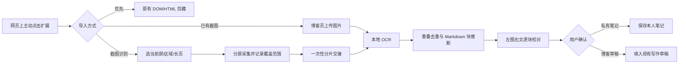

# 长截图 OCR 转 Markdown 与私有笔记设计 V3.0

> 本文记录已落地的本地 OCR/校对流程与交互契约；配图检测实现和仍待真实样本验证的部分见 [截图 OCR 跨屏图片识别设计 V3.1](截图OCR跨屏图片识别设计V3.1.md) 与 B-048。

> 2026-10-05 交互修订：长截图改为在正文上拖出完整矩形。四条边固定在视口中，用户滚动页面或正文容器时，只截矩形内新出现的内容并拼接；矩形外的顶部导航和底部遮挡物不进入长图。采集坐标以矩形上边缘为准，第一屏保留用户框选时的位置。博客校对页仅对最终拼图运行一次 OCR。框选宽高均至少 120px，框必须与正文滚动容器有足够交集。真实目标网页的遮挡、懒加载和复杂滚动仍需人工对照核验。

> 2026-10-04。状态：**本地 MVP 已实现并通过自动化回归，真实网页与人工质量验收未完成**。对应缺陷 B-045，尚不能关闭。此方案扩展现有通用网页剪藏，不替换 HTML 剪藏、不改变文章审核和私有笔记权限；不承诺任何站点都能完整获取或无损转换。

## 1. 结论和适用范围

可行，但“长截图插件 + Markdown 插件”不能简单串联成可靠的一键功能。长截图得到的是像素，Markdown 要的是文本、阅读顺序和语义结构，中间必须有 **OCR、版面重建、人工校对**。两个现成扩展一般只提供下载图片/复制文本，并无稳定的跨扩展交接、来源坐标、分片续传或私有笔记 API。推荐把截图能力接入本项目已有 MV3 扩展，把 OCR 和校对放在博客网页；同时允许用户上传其他截图扩展导出的 PNG/JPEG/WebP，作为不依赖扩展内部接口的兼容入口。

优先级：正常网页仍使用现有 DOM/HTML 剪藏，保留链接、代码、表格和图片信息；只有 DOM 抽取失败、正文实际以图像绘制、复制受限而用户**已经可以正常看到**内容时，选择截图 OCR。截图只捕获屏幕上实际呈现的像素；登录后不可见部分、付费墙后内容、未加载的页面均无法通过此功能获取。导入默认形成**本人的私有笔记草稿**；要成为博客文章，作者另选“博客草稿”、核对来源与使用许可，最后沿用现有提交/审核流程。

例如用户提到的面试鸭问答页：先用 DOM 剪藏；若正文可见但 DOM 无法可靠抽取，用户在该页手动选择截图识别。只处理已经加载且对该账号可见的内容，不读取 Cookie、隐藏接口或付费内容，也不把他人题解自动标成原创。

## 2. 现状和组件复用

| 组件 | 当前事实 | 设计处理 |
| --- | --- | --- |
| `browser-extension/manifest.json` | MV3，`activeTab`、`scripting`、`storage`，无广域 host permission；popup 用于手动剪藏。 | 新增“截图识别”按钮，仍由用户点击启动；首期无需 `debugger`、`cookies`、`webRequest` 或 `<all_urls>`。 |
| `browser-extension/shared/clip-flow.js` 和 `frontend/src/features/blog/utils/webClipHandoff.ts` | v2 HTML 交接约束为 2 MiB、64 KiB 分块、一次性 ACK、5 分钟 TTL。 | 截图另设 `screenshot-v1` 协议，不提高 HTML 上限，不把 base64 图片塞进 v2 HTML。复用 origin/tab/nonce 的安全思路。 |
| `HtmlImportDialog.vue` 与 HTML 预览 API | HTML 转 Markdown、逐块确认。 | OCR 的输入不是 HTML，另设截图校对视图，复用最终 Markdown 预览和写作草稿应用逻辑；不能把 OCR 文本伪装成 HTML 走旧解析器。 |
| `PrivateNote` | 已有私有 Markdown 内容和来源 URL、标题、时间；受 owner/workspace 约束。 | 确认后保存到此模型。OCR 未确认的原图和识别结果不自动落库。 |
| `PrivateNoteImage` | 每图上限 5 MiB，有私有读回；面向最终笔记配图。 | 不充当几十 MiB 的截图暂存仓。仅当用户明确选择保存源截图、并满足限制时才考虑作为最终附件；长页源图另行设计配额。 |

## 3. 用户流程

1. popup 显示“网页剪藏”“截图识别”两个入口。截图入口提供当前屏、手动区域、长页范围三种模式；**默认先选需要的区域/终点**，避免把整站导航、个人资料或评论都录入。其他截图扩展导出的图片可在博客页的“导入截图”直接选择文件。
2. 开始前展示来源域名、预估页长、预计张数、是否可能含个人信息及上限；用户确认后才滚动页面。采集中显示进度、取消和“当前页可能为动态列表”的提示。结束后恢复原滚动位置。
3. 博客页首先核对是否已登录，再从扩展消费临时截图。OCR 默认**仅在当前浏览器运行**；模型文件从本站同源静态资源加载，不调用第三方 OCR API，不上传截图。设备不支持/模型加载失败时提供“保存截图后稍后重试”，不偷偷切到云 OCR。
4. 校对页左侧显示对应截图区域并标识已覆盖/未覆盖，右侧逐块编辑并预览 Markdown。点击文字块定位源图，通过上移/下移按钮调整块顺序、修标题层级和代码文字；低置信度文字显著标注。用户可删去导航广告和隐私内容。拖动排序、代码语言自动识别、表格结构恢复和涂黑工具尚未实现。
5. 仅点“保存私有笔记”或“应用到博客草稿”才持久化。已有笔记/草稿有未保存修改时提示合并或取消，不静默覆盖。博客草稿仍需本人主动提交，公开审核逻辑不变。可下载 `.md`，但下载不是自动发布。

## 4. 截图采集设计

[Chrome tabs API](https://developer.chrome.com/docs/extensions/reference/api/tabs) 的 `captureVisibleTab` 只截**当前可见视口**，官方上限是每秒 2 次；`activeTab` 可在用户操作后给予当前页临时权限。因此长页采用“滚动—稳定等待—截视口—记录坐标”的循环，不使用网页内部 API 或绕过站点限制。

- **边界**：首版只支持一个普通 HTTP(S) 标签页的主文档/一个明确的滚动容器；建议最多 12 张视口、12,000 CSS px、压缩后 20 MiB、单次 60 秒。限制是初始工程预算，须经真实页面测试调整。超限提示缩小范围或分段导入，绝不静默截断。
- **采样**：每次向下移动约 85%—90% 视口高度，保留 10%—15% 重叠；同一页同一缩放比和 DPR，记录 `scrollX/Y`、viewport 尺寸、DPR、实际图片像素尺寸、时间戳、页高。每次截图至少间隔 700 ms，等待滚动/字体/图片稳定并设置超时；最终以图像特征和 OCR 坐标去重，不按固定像素硬裁掉可能跨屏的文字。
- **状态**：开始前记录 tab/window ID、URL、滚动容器、原位置。截图前后验证当前激活窗口/标签、URL、viewport 和缩放是否仍匹配；用户切标签、手动滚动、页面导航、尺寸改变或超时即终止并显示已截范围。只在确认源 tab 仍是目标时恢复滚动，避免在新页面误操作。
- **复杂页面**：固定导航/悬浮侧栏优先由用户选择正文区域排除；不能改站点布局或在截图后假定已完整排除。无限滚动、虚拟列表、内嵌滚动 iframe、视频/canvas、动画或登录弹窗可能无法形成稳定长图，降级为当前屏/手动区域或上传截图。应显示“已覆盖 X–Y，未确认是否为整篇”并让人确认，不能报告“全文完成”。
- **内存**：OCR 按视口图片逐张运行，保留坐标和少量重叠区域，不先拼出一张超高位图。仅小页可选导出拼接图；长页若要下载截图，输出多张编号图或 ZIP（另评估依赖与配额）。截图 UX 是连续长页，内部处理为分片，避免 Canvas 尺寸和内存上限。

采集逻辑由 content script 读取滚动几何并请求 service worker 调 `captureVisibleTab`；不要在 content script 假定有 tabs API。popup 关闭或 MV3 worker 中断时必须根据 session 记录恢复到“可取消/可重试”，不得自动从中途继续并造成重复。按浏览器 API 的实际行为做 Edge/Chrome 侧载实验，特别测试缩放、Retina/DPR、跨屏和焦点切换。

## 5. 扩展到博客的二进制交接

`chrome.storage.session` 官方默认约 10 MB，浏览器或扩展重启即清空，且现有 HTML 协议只有 2 MiB；**不适合直接存长截图**。[存储 API 说明](https://developer.chrome.com/docs/extensions/reference/api/storage)。建议扩展 IndexedDB 临时存 Blob，`storage.session` 只存 nonce/元数据；图片总量上限 20 MiB、每个用户操作最多一个活动会话、15 分钟 TTL。IndexedDB 可能跨重启保留，故启动/打开 popup/ACK/取消时按 TTL 清理；正常成功后立即删除。不能把截图写进 `storage.sync`、URL fragment、日志或剪贴板。

新 `screenshot-v1` 只允许配置过的本站 origin 通过 `externally_connectable` 消费；博客页仍按登录状态启动接收。流程：

1. 扩展生成 128-bit 随机 nonce，将 `kind=screenshot`、目标 origin/tab、来源 URL/标题、覆盖范围、tile 数、每 tile `mime/bytes/sha256/width/height/scrollY` 和总字节写入会话元数据；打开博客页，只把 nonce/扩展 ID/kind 放在 fragment，博客页立刻清除 fragment。
2. 站内调用 `get-meta` 后，按序 `get-tile-chunk(tileIndex,chunkIndex)` 拉取固定小块（建议 base64 64 KiB 级别，最终限制以真实浏览器消息测试确定）；每块序号、总长与 SHA-256 校验。一次只组装一张，传入 OCR worker 后释放内存。不能靠浏览器消息传输“无限大的一个 data URL”。
3. 扩展核对消息类型、版本、nonce、TTL、发送方 origin 和目标博客 tab；每个 tile 的读取可重试，最终 `ack` 原子消费整个会话并清理 Blob。校验失败不 ACK；取消/过期删除所有片段。重复消费、跨 origin、错 tab、错页和超限应返回稳定错误码。用户刷新博客页可在 TTL 内继续，但同一 nonce 不得被不同页面抢走。
4. 扩展和站内都把收到的图片元数据当不可信输入，验证 MIME、文件签名、尺寸、像素数与总量。禁止 SVG/HTML 文件冒充截图，禁止将 OCR Markdown 当可信 HTML 直接插入 DOM。来源 URL 去追踪参数；不把 URL 作为服务端抓取地址。

已有第三方截图扩展若支持“保存整页图片”，本站上传入口直接读取该文件，复用后续 OCR/校对；无需调用对方扩展私有 API。若将来确实复用其代码，必须固定版本并评估许可证和权限。[OpenCapture](https://github.com/Open-Capture/OpenCapture) 提供本地长页截图参考但采用 AGPL-3.0-or-later；[Copyfish](https://github.com/A9T9/Copyfish) 可作为 OCR 交互参考但采用 GPL-2.0 且使用 OCR.space API。不直接拷贝两者源码或把私有截图发到其 OCR 服务。

## 6. OCR、结构重建与校对

| 选项 | 能力与取舍 | 决定 |
| --- | --- | --- |
| 浏览器端 PP-OCRv5 | 中文模型和 ONNX Runtime Web 可在 worker 中运行；返回文字行、坐标、分数。需随前端部署约 21 MiB 模型及 WASM 资源，首次加载和低配设备耗时；本身不保证 Markdown 标题/表格语义。 | **首期已采用**：`ppu-paddle-ocr@6.6.0`、`pdfmarkdown-ppocrv5-models@1.0.0`、`onnxruntime-web@1.23.2` 锁定在 package-lock；构建前由 `frontend/scripts/sync-ocr-assets.mjs` 生成同源静态资源。合成图片已在 Edge 跑通，真实网页质量尚未测定。 |
| Tesseract.js | 浏览器 OCR 成熟、基线容易搭，但复杂排版/中英混排及表格重建仍需要额外处理。 | 性能/准确率对照，不默认叠加两个 OCR 引擎。 |
| PP-StructureV3 服务端 worker | 官方版面、表格、公式、阅读顺序及 Markdown 导出能力更强；需要隔离 worker、资源预算、图片上传和隐私确认。 | 二期**可选增强**，不能塞进现有 Railway web 请求线程或未测资源成本就默认开启。 |
| 通用大模型识图 | 对复杂语义可能有帮助，但费用、隐私和凭空补写风险高。 | 不作首期依赖；若以后接入，只能用户明确选择、展示传输范围，并对照原图逐块核验。 |

官方资料：[PaddleOCR.js 浏览器文档](https://github.com/PaddlePaddle/PaddleOCR/blob/main/docs/version3.x/inference_deployment/cross_platform/browser.md)、[PP-StructureV3 文档](https://www.paddleocr.ai/main/en/version3.x/algorithm/PP-StructureV3/PP-StructureV3.html)、[Tesseract.js](https://github.com/naptha/tesseract.js)。即使 OCR 识字率高，也无法从像素确定作者本来使用的 Markdown 源码；例如 `#` 层级、列表缩进、链接目标、代码语言、表格合并单元格和数学语义只能推断或人工重建。

首期 Markdown 重建采用可解释规则：识别行按 `(tile, y, x)` 排序，利用重叠区域坐标和文字相似度去重；字号/行距/缩进/编号推断标题、段落、列表、引用；等宽字体/背景候选推断代码但保留逐行文本，不自动指定语言；表格仅在网格清楚且列稳定时转 Markdown 表，其余作为图片块或“待人工整理”；公式保留源图并标注“需校对”，不捏造 LaTeX。对每块保留 `text、kind、confidence、tile_id、bbox、warnings`，校对结果由用户编辑，最终 Markdown 不包含内部坐标标记。OCR 原文与人工改写在预览阶段可回退和比较。

截图中的原有图片/图表无法通过 OCR 自动变成 Markdown 图片资源。若用户选择保留插图，必须裁出对应区域、私有/草稿图片上传成功且读回校验后才写入本地图片引用；失败时保留图像占位警告和可重试入口，不能留下不可用外链。公开文章的图片仍遵守现有媒体权限和审核流程。

## 7. 数据、接口和权限

**一期：不新增后端 OCR API 或数据库表。** 截图和未确认识别结果仅保存在扩展临时 IndexedDB 与博客页内存；最终私有笔记复用 `PrivateNote` 创建/更新接口，博客草稿复用当前写作页本地草稿和提交接口。导出 `.md` 是本地操作。若用户手工上传其他插件生成的截图，文件只进本地 OCR，默认不上传服务端。这样能先验证价值，并减少迁移、存储和清理风险。

如果二期启用服务端结构 OCR，新增独立的 `OcrImportJob` 与**私有临时对象存储**，不复用 HTML preview 或公开媒体桶；建议字段 `id(UUID)、owner_id、workspace_key、status、source_url、tile_count、total_bytes、model_version、created_at、expires_at、error_code`，tile 对象只在私有桶，任务完成/取消后 24 小时内清除；用户若另选“保留源图”再显式复制到持久私有附件。接口建议为 `POST /api/agent/blog/imports/screenshot/jobs/`（建任务）、`PUT .../{id}/tiles/{n}/`（逐张二进制上传与哈希）、`POST .../{id}/run/`、`GET .../{id}/`、`DELETE .../{id}/`。全部要求真实 JWT、owner/workspace 强校验、CSRF/Cookie 契约、限流、配额、尺寸/解码炸弹检查，非 owner 返回 404；任务只返回待审 Markdown 块，不自动建文章。服务端不得下载 `source_url`。任务应幂等、可取消、带状态和错误码；worker 与 web 分离。此为未来接口草案，**尚无代码和迁移**。

## 8. 安全、合规和失败处理

- 只处理用户可访问、可见且有权保存的页面；不绕过登录/付费/技术限制，不做批量抓取或定时监控。截图能读出网页不代表拥有转载或公开发布权。来源卡清楚标注页面地址、截取时间和用户选择范围，公开前单独确认来源与图片使用权。
- OCR 输入可包含恶意文本或页面中的 AI 指令；全部按数据处理，不能作为系统指令执行。Markdown 渲染走现有 XSS 清洗和链接安全规则，图片 Blob URL 及时释放。
- 图片可能含账号、姓名、聊天、手机号。一期提供手动区域裁剪，**尚无涂黑工具**；用户需要先在截图前处理敏感信息或改用外部工具。本地默认处理；二期任何服务器/第三方处理均单独提示、显式同意。没有隐私同意不自动降级到云服务。
- 对 0 内容、只截到导航、低置信度、图片懒加载失败、遮挡、分片缺失、哈希不符、超时、存储满、模型加载失败、设备内存不足分别给出可操作错误。任何失败均不得覆盖已有笔记或草稿；可导出已经截到的图以免重做。
- 记录诊断只含错误码、阶段、片数、耗时和设备档位；不记正文、原图、完整 URL、Cookie 或授权头。

## 9. 分阶段实施与验收

| 阶段 | 最小交付 | 通过门槛 |
| --- | --- | --- |
| A：样本与原型 | 先收集**有权使用的**中文文章、代码、表格、长图和异常页面；在隔离 Edge/Chrome 验证 `captureVisibleTab`、滚动容器、权限与本地 PaddleOCR.js 模型加载；锁定依赖及模型许可/体积。 | 对至少 10 个真实页面记录可截范围、总字节、耗时、OCR 初步错误，列出不支持类型；此阶段不宣称产品完成。 |
| B：截图与交接 | 新 popup 入口、区域/当前屏/长页采集、进度/取消、20 MiB 上限、IndexedDB TTL、`screenshot-v1` 分片校验；站内也可直接上传第三方截图文件。 | 无误导性“全文完成”；切 tab/导航/滚动/超限可停止并恢复原位置；跨 origin、错 tab、过期、重放、缺片、损坏和双消费都失败且不泄露图片。旧 v1/v2 剪藏回归通过。 |
| C：本地 OCR 与审稿 | worker OCR、坐标去重、块级 Markdown、截图对照编辑、下载 `.md`、私有笔记和博客草稿应用。 | 20 个获授权真实样本（含中文、英文、代码、表格、长页）逐项人工比对；**清晰正文**字符错误率目标 ≤3%，跨屏重复/漏行占比目标 ≤2%，正文阅读顺序正确块占比目标 ≥95%。代码、数字、公式、表格必须逐项校对，不以平均识字率掩盖关键错误。目标值是验收标准，未实测前不当成果。 |
| D：增强与上线门禁 | 在真实需求证明首期不足后，评估独立 PP-StructureV3 worker、私有临时对象存储和用户选择的增强模式。 | 先有资源/隐私/费用预算；对相同人工标注集证明相对本地方案改善；真实 HTTPS、Bucket、跨 workspace、安全和清理验收后才启用。 |

另设用户任务：至少 5 位目标用户各完成“打开受限但可见的长网页 → 截取所需部分 → 修正两处 OCR 错误 → 存为私有笔记 → 下次打开可读”的任务；目标成功率 ≥80%，中位完成时间和重试次数逐人记录。不能用自动化 fixture 冒充真实用户结果。真实 Edge 扩展侧载与 5174 桌面入口均需验收；桌面默认端口不改变。

## 10. 设计决策与实施顺序

本方案选择 **扩展负责像素采集、博客页负责本地 OCR 和校对、现有私有笔记负责持久化**。它复用当前用户入口和认证边界，也允许外部截图插件的导出文件进入相同后半段流程。先完成 A 的真实性验证，尤其是 PaddleOCR.js 对中文代码网页和 Edge 的性能；若不达标，重新比较浏览器 OCR 与独立服务端 worker，而不是把未验证的依赖带入生产。B/C 每阶段独立提交和回归，任何失败可停用截图入口，不影响原有 DOM/HTML 剪藏。

**2026-10-04 实现核对**：扩展已有当前屏、手动区域、长页截图、覆盖范围/中断提示、IndexedDB 临时存储及 `screenshot-v1` 分块校验；博客页已有同源本地 OCR worker、左图右文逐块校对、Markdown 预览/下载、默认私有笔记草稿与可选博客草稿。用户主动裁剪的插图按目标写入私有笔记图片或博客媒体。OCR 失败后可在当前对话框重试并逐张下载源图。无需新建后端 OCR 表或 API，桌面端 5174 保持不变。

**插图保存目标切换**：裁剪后在当前校对会话内保留原裁图文件。若用户随后在“私有笔记”和“博客草稿”间切换，应用内容前会向目标图片接口重新上传、读回确认并替换 Markdown 地址。私有图片转博客媒体前必须明确提示该裁图将可通过图片地址访问，取消不上传；失败时保留校对界面，不能携带旧权限地址进入另一目标。手工粘贴且没有本地裁图文件的跨权限图片地址不能自动转换，需在目标重新插入。此处理不改变文章提交与审核流程。

**宽度选区与拼接增量（2026-10-04）**：长页入口先在网页上横向框选正文，再设纵向起终点；扩展按既有节流与总量上限自动滚动截图，传递归一化横向范围和纵向范围。站内验证协议后，在本地逐屏裁剪再按页面滚动坐标拼为一张可下载长图，OCR 仍逐屏运行以保留性能与定位。校对页可从拼接图通过两次点击选择跨屏图片，压缩后仍遵守上传服务的 20 MP/5 MiB 上限。导航/侧栏/悬浮图片不进入自动配图候选，采集时临时隐藏固定或粘性导航并恢复。当前不支持鼠标拖动时实时截图；懒加载、嵌套滚动、动态布局与真实 `captureVisibleTab` 像素仍需人工场景验收。

**自动化证据**：扩展 Node 测试 50/50、前端单元 16/16、隔离 Edge 截图专项 11/11、`npm run build:check` 通过。Edge 用例包含同源真实模型 OCR 和合成图片、扩展交接及权限隔离；截图采集的像素 API 在自动化里用合成 tile 代替。真实网页手动侧载捕获、10/20 份真实样本的速度与识别质量、5 位用户任务、生产环境 HTTPS/资源加载仍待验收。这里的准确率与任务成功率目标尚无实测结果，不能称 B-045 已关闭。

**本地单端口故障修复（2026-10-04）**：`start.bat`/`start.sh` 构建出的 `frontend/dist/models/ocr/` 与 `frontend/dist/ort/` 原先未在 Django URL 中注册，`/models/ocr/manifest.json` 被 SPA 兜底返回为 HTML，浏览器报 `Unexpected token '<'`。现已在 Django 和 Nginx 为这两类资源设置静态路由和缺失文件 404，OCR worker 对非 JSON 清单给出可操作错误。新增 Django 回归测试并用实际 `dist` 资源核对清单、模型、WASM 均返回 200；上线后还须在实际 HTTPS 环境复核。

**截图配图保留增强（2026-10-04）**：扩展在每张视口截图前只采集已加载、可见、面积达到阈值的 `` 归一化屏幕矩形，不采集原图 URL 或绕过浏览器对跨域图片的限制。`screenshot-v1` 元数据对每张图最多保留 12 个有限矩形；站内再次校验。校对页用黄色框提示候选，用户点击后检查/调整裁剪，主动选择私有笔记或博客草稿目标并上传；仅上传截图中裁出的像素，成功读回后把图片 Markdown 放在附近文字块。普通图片文件上传、旧扩展任务、CSS 背景图/canvas/iframe 图片仍由“手动框选页面配图”兜底。该流程不能自动确定图片版权、裁剪是否包含隐私或页面图片的准确边界，因此不在未经用户确认时批量上传。

**手动滑动采集的当前实现（2026-10-04）**：上述原型的「预设终点、自动滚动」已改为用户框选宽度及起点后手动向下滑动；停顿约 450ms 触发一轮采集，85% 视口步长补齐快滚空隙，按每屏实际 `scrollY` 拼接。自动补拍的程序滚动不再冒充用户滚动；停止滑动后不轮询。每帧采集前后核对滚动位置，连续变化时最多重试 3 次，然后保留已截部分并显示错误。HUD、固定导航在重复帧、达限和异常后也恢复；「完成」等待当前采集排空；MV3 后台失去会话时由 HUD 定时检查并提示重试。当前上限为 24 屏、24,000 CSS px、20 MiB、5 分钟；真实像素采集、嵌套滚动/虚拟列表与人工 OCR 质量验收仍未完成。前文中 12 屏/12,000px/60 秒与自动滚动是初始设计预算和历史记录，不代表当前实现。

**明确提交时机修正（2026-10-04）**：采集第一屏、到达页面底部、达到 24 屏/24,000px/20 MiB/5 分钟上限及中途采集失败，都只更新或暂停源网页上的 HUD；不保存交接会话、不打开博客。用户滑动结束后必须主动点「完成」（或按 Esc），此时先排空正在补拍的屏，再保存已截内容并打开博客。点「取消」则放弃。即使起点所在视口已覆盖页面底部，也保留 HUD 等待明确完成操作。

**动态页面高度修正（2026-10-04）**：开始截图时读取的 `scrollHeight` 只用于面板显示，不用于判断已到页面底部或自动暂停。懒加载、展开区块可能继续增加页面高度；用户继续向下滑动时按新的实际滚动坐标采集。是否已截到所需结尾由用户自己判断并点「完成」。24 屏/24,000px/20 MiB/5 分钟仍是资源上限，到限仅暂停并提示，不自动提交。

**框选滚动容器与增量预览（2026-10-04）**：框选命中点沿 DOM 祖先查找可滚动正文容器；若不存在则使用窗口。松开框选鼠标即开始第一屏，不再要求额外点击开始。后续滚动监听、程序补拍定位、采集前后坐标核对使用同一个滚动目标，避免内部 `overflow-y:auto` 滑动不触发整页 `scroll` 的问题。内部滚动时按容器当前可见矩形裁切截图上下方页面区域，tile 的 `scrollY` 是容器的 `scrollTop`，站内沿用原有按坐标裁剪拼接；第一屏沿用框选时的实际视口，不强制把起点滚到容器顶部。每张 tile 只把尚未覆盖的纵向区域和所选横向宽度缩为 170px JPEG 发给页面 HUD，按顺序追加为小预览；原始截图仍只在扩展 IndexedDB 保存、完成后交接。容器尺寸/位置变化时停止并提示重试，跨域 iframe 与虚拟列表的滚动仍不保证覆盖。实际目标网页的工具栏完整操作需人工验收。

**真实链路补测与修正（2026-10-04）**：原有内容脚本单测和 worker 裁图单测均通过，却未发现消息桥接漏传 `captureTop`/`screenHeight`/`initialScrollY`，以及 `prepareCapture` 把内部滚动误报为整页 `window.scrollY`。现用临时测试扩展副本运行真实 `captureVisibleTab` 整链路：框选内部滚动正文、第一屏预览、滑动后第二段预览、点击完成打开博客。测试副本以 `<all_urls>` 模拟工具栏点击获得的 `activeTab` 授权，生产 manifest 未增加权限；真实用户网页仍需人工验收。采集失败提示不再 8 秒后自动消失，便于读取具体原因。

**最终长图单次 OCR（2026-10-04）**：此前设计和实现是逐视口 OCR 后重叠去重。现在用户要求博客页只识别最终拼好的整图，因此长页接收后先按选区裁每张图并合成一张长图，完成后只把该长图送入本地 OCR worker 一次。识别块 bbox 直接对应整图，源图对照区在整图上显示可点击识别框；逐屏原图仅留作下载和配图候选检查。拼图失败或多图缺拼接参数时停止识别并显示原因，不回退到逐屏 OCR。双 tile 隔离浏览器用例监测 worker `recognize` 消息恰好 1 次；真实超长页面仍受图片 20 MiB、20,000px 单边、30 MP 和本地 OCR 超时限制，可能需要缩小范围分段采集。前文逐屏 OCR 是历史方案，以本段为当前行为。

**识别置信度增强（2026-10-06）**：针对“部分行置信度偏低”的反馈，借鉴 PaddleOCR 官方 FAQ 与社区做法做了三处识别链路增强，全部只影响识别输入质量与二次识别，不编造文本、不改动人工校对边界。其一，`ocrWorker` 显式设置识别源图上限 `maxCropSourceSideLength: 8192`：ppu 默认从最长边 2000px 的缩小副本上裁识别输入，DPR≥1.25 的屏幕截图（2500–3840px 宽）此前每行都先被降采样再识别，直接拉低置信度。其二，不确定行重试新增第二轮“图像调理”识别（`ocrRecEnhance.ts` 纯函数 + worker `enhanceUncertainRows`）：黑底白字行反色、低对比度行按 p5–p95 线性拉伸、行高 <16px 的小字 2 倍（<10px 3 倍）平滑上采样后识别，每段最多 12 行、每行一次推理，均匀色块跳过；只有“分数比现任高 ≥0.08 且长度可信、无替换字符”才替换，读出相同文本但真实分数更高时仅上调置信度（消除暗色/小字正确行的假低分警告），其余候选照旧进入 alternatives 供校对。其三，重试资格从“高≥12px/宽≥70px/≥4 字符”放宽为“高≥9px/宽≥24px/≥2 字符”，小字与短标签也有第二次机会。置信度=CTC 各时间步最大概率均值，改善裁剪即直接改善分数。PP-OCRv5 server 识别模型（约 84MB）精度更高但需联网下载并显著增加 WASM 耗时，暂不引入；若后续实测仍不达标再评估。单测 50/50（新增 `ocrRecEnhance` 6 例）、`npm run build:check` 通过、隔离 Edge OCR 专项 6/6 通过（真实模型走完新重试链路；B-051 私有样本验收仍需显式 OCR_REAL_SAMPLE_PATH）；真实暗色模式/小字截图的 A/B 对比仍待人工验收。

**校对警告的清除语义（2026-10-06）**：用户反馈“文字已修复但警告常驻”。修正两处：其一，备选警告（“同一文字框的 OCR 备选…请对照原图”）此前不看主读法置信度一律提示，二次识别引入后落选候选进备选，高置信度块反而警告变多；现在仅主读法置信度 <0.9 时提示，备选照旧留档。其二，块的低置信度标记与校对类警告只在 OCR 推断时计算一次，用户改对文字也不消失，且长图分片合并会用新鲜块覆盖回来；现在定义 `isProofreadWarning`（低置信度/备选/标题置信度/代码候选/表格提示五类前缀），用户编辑过文字、类型或层级的块视为已校对，`markEdited` 清除其校对类警告与 lowConfidence 标记，分片合并对已校对块不再覆盖回来；图片权限等状态提示不属于校对类，编辑文字不清除。单测 52/52、`npm run build:check`、隔离 Edge OCR 专项 6/6 通过。

**插图插入位置自动预填（2026-10-06）**：用户反馈插图仍要手动选插入位置。根因有三：插入位置推算函数只认整图/单图 OCR 的块（tileIndex -1），逐屏 OCR 流程（扩展长图逐屏识别）里块是屏内坐标，推算恒返回“正文末尾”；“手动框选页面配图”入口从不预填；重新框选后预填也不跟随新位置。现统一为：裁剪框（归一化后）纵向中心决定默认插入序号——整图 Y 先换算回所在屏与屏内坐标，再取其下第一个文字块之前，逐屏与整图两种坐标系都支持；候选点击、手动框选完成（松开鼠标/长图第二次点击）、重新框选后都会自动预填；用户在本次裁剪会话中于下拉里明确选择过则尊重其选择不被覆盖，上传时仍有三级兜底（用户选择 > 框位置推算 > 选中块之后/末尾）。此预填只是默认值，符合 V3.1 §4.C“按候选中心纵坐标与 OCR 块位置确定，用户可改”。`npm run build:check`、单测 52/52、隔离 Edge OCR 专项 6/6 通过；多屏真实页面的预填准确率仍需人工验收。

**多图只保留最后一张的修复（2026-10-06）**：用户连续插入多张插图时，之前插入的引用块全部消失、只剩最后一张。根因是“只保留图片”策略的覆盖过滤：插图引用块与手动添加块的 bbox 为零面积，重叠判定 `0 < 0` 恒为 false，被判为“被插图覆盖的文字”整体删除。现把覆盖判定抽为 `screenshotOcr.isTextCoveredByRect`（零几何块永不算覆盖，OCR 块按 ≥50% 重叠判定），上传过滤与分片重发布过滤共用同一实现；单测补零几何/全覆盖/部分重叠/不相交四类断言（53/53），`npm run build:check`、隔离 Edge OCR 专项 6/6 通过。连续插入的端到端场景仍无自动化覆盖（现有 e2e 不点上传按钮），依赖用户真实使用验收。

**插图插入位置下标漂移修复（2026-10-06）**：用户反馈自动预填的位置“有些偏差”。根因：预填与手选保存的都是数字下标快照，而长图的图片候选在 OCR 仍在流式识别时就可点选——从预填到确认上传之间文字块不断追加（分片合并也会重建列表），同一数字下标指向的块已经不同；上传与分片重发布再按这个过时下标 splice，插图就落在漂移后的位置。现改为锚定块 id：`applyAutoInsertIndex` 与下拉手选（`onFigureInsertSelect`）都同时快照“插入到某块之前”的目标块 id（"end" 表示正文末尾），上传时 `resolveFigureInsertAt` 按当前列表重新解析下标（锚块被删则退回快照/现算兜底），`uploadedFigures` 新增 anchorId 供分片重发布按 id 重解析。裁剪坐标换算链（裁剪后 tile 的 scrollY/coveredCssHeight、拼接图线性映射、整图 OCR 块坐标）经核对一致，未改动。`npm run build:check`、前端单测、隔离 Edge OCR 专项 6/6 通过；预填精度仍依赖用户在真实长图上验收。

**校对区源图直接拖选配图（2026-10-06）**：像素/DOM 候选漏判时，用户此前只能点工具栏“手动框选页面配图”切到裁剪步骤，在压缩后的长图上两击框选，不直观也不顺手。现在校对页源图（拼接长图与各屏源图）支持直接按住拖拽圈选配图：mousedown 记录起点、拖拽中显示实时虚线选框（复用裁剪框样式，pointer-events none 不挡交互）、窗口级 mouseup 兜底收尾（拖出图片边缘用最后已知位置结束）；位移 <8px 视为普通点击，不影响既有的块定位与候选点选。拖选完成后进入与候选点击完全相同的确认流程（裁剪预览、插入位置按裁剪框自动预填并锚定块 id、确认后才上传）。无候选时的提示文案同步改为引导拖选或工具栏入口。该入口不改变“自动检测只提议、用户确认才上传”的边界，也不会静默保存。`npm run build:check`、前端单测、隔离 Edge OCR 专项 6/6 通过；拖选手势在真实触控板/触屏上的可用性仍需人工验收（当前只绑鼠标事件）。
